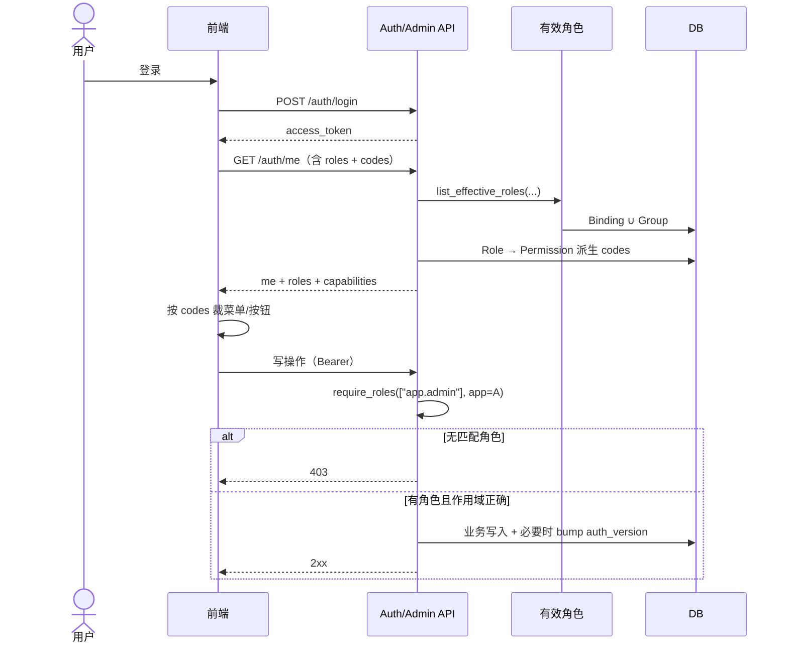
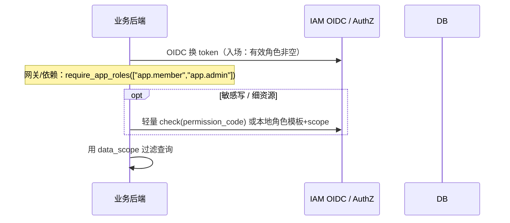

# 改造方案：前端拿权限码、后端判角色

> **【P392 更正（2026-10-28）】** 本文角色 key 以新口径为准：L1 `platform.admin`、L3 `tenant.admin`（L2 `app.admin`/L4 `app.member` 不变）；capabilities 中的权限码为五域 27 码体系。下文出现的 `platform.super_admin`/`tenant.org_admin` 为落地时的历史写法。

> **状态：** 核心已落地并关单（2026-10-24 17:21 Asia/Shanghai）。`/auth/me` 含 roles+capabilities；`ensure_roles`/`require_roles`；管理门禁按角色；SDK `require_roles`/`requireRoles`；DeerFlow `require_app_roles`；对接手册已写明「前端码、后端角色」。浏览器四级全角色 UI 走查受执行器无 GUI 限制，以 API+既有 P341 证据为准。
> **对照基线：** 方案 A 绿场 RBAC（`docs/plan-a/`）  
> **本机项目：** `D:\project\role`  
> **相关现状：** capabilities、`evaluate_access`、OIDC、SDK 2.x、DeerFlow 已按方案 A 落地  

---

## 一页结论（可转给产品/业务方）

**用户意图对齐：** 登录后拉用户信息；前端用**权限编码**裁菜单/按钮；后端写接口时**主要按角色**鉴权，而不是每个路由再写一长串权限码。

**推荐默认（不是「后端完全不看权限码」）：**

| 层 | 做什么 |
|----|--------|
| 登录 / 会话 | 返回用户身份 + **有效角色列表** + **由角色派生的权限码集合（capabilities）** |
| 前端 | 只信 capabilities **做 UI**（菜单、按钮、路由）；不把码当安全边界 |
| 管理台 / 租户台 API | 改为 **`require_roles([...])`**（按 L1/L2/L3 角色 key + 作用域）；权限码表仍保留，供前端与配置 |
| 业务 API（DeerFlow 等） | **入场看角色**（如 `app.member` / `app.admin`）；**资源级授权**优先「角色模板 + data_scope 策略」，敏感操作可保留**轻量权限码 check**（可选，见决策 §4） |
| 安全底线 | 前端权限码**不可信**；后端至少验角色（及租户/应用作用域）；解绑仍 bump `auth_version` |

**与现行方案 A 的关系：** 方案 A 是「前后端都按权限码 `require_permission`」。本方案是在同一套「有效角色 → 权限码派生」数据模型上，把**后端门禁单位从码改成角色**，前端继续用码。数据模型大体可复用；改的是守卫 API、管理路由挂载方式、以及文档/SDK 契约。

**不建议：** 删掉 Permission 表、只把权限码塞进 JWT 长期缓存、或业务查询只靠前端传「我有哪些码」。

---

## 1. 目标模型

用白话对齐意图：

```text
登录成功
  → GET /auth/me（或合并接口）拿到：
      - 用户基本信息
      - roles[]：有效角色（含 key / kind / tenant_id / application_id）
      - permission_codes[] 或 capabilities：由角色派生的权限编码
  → 前端：用 permission_codes 裁剪菜单、按钮、路由（体验层）
  → 后端：路由/服务入口用「是否具备某角色（在正确作用域内）」判断能否调用
```

### 1.1 一句话目标

**「角色是安全边界，权限码是体验清单。」**  
角色决定「能不能进这扇门」；权限码决定「门里哪些按钮亮」。业务资源「能看哪些行」继续靠 **data_scope（或角色绑定的范围策略）**，不要靠前端传码。

### 1.2 目标交互（管理台）



### 1.3 目标交互（业务应用，如 DeerFlow）



---

## 2. 与现行方案 A 的差异

| 维度 | 方案 A（现行） | 本改造目标 |
|------|----------------|------------|
| 后端管理 API 门禁 | `ensure_management_permission(code)` / 按权限码 | **`require_roles([role_key...])` + 作用域** |
| 前端 | capabilities 按码裁剪（已落地） | **保持**：仍按码裁剪 |
| `evaluate_access` | OIDC + SDK check 按有效角色展开**权限码**再判 | **入场/网关**：角色；**可选细粒度**：仍可按码或「角色→模板权限」 |
| SDK 2.x | 业务 `require(permission)`，强制 data_scope | **主路径改为角色门禁**；data_scope 挂到「角色策略」或保留「码 + scope」双轨（见 §4.4） |
| Permission 表 | 前后端共同依赖 | **保留**：配置中心 + 前端派生源；后端写路径不再强制「每路由一码」 |
| 有效角色 | 唯一真相源 | **不变**：继续 `list_effective_roles` |
| L2 ↛ L3 / L3 ↛ L2 | 靠不同管理码集合 | **改为角色互斥 + 作用域**（码矩阵变为角色能力说明，仍可派生给前端） |
| 安全原则「后端强校验」 | 强校验的是**码** | 强校验的是**角色**（码仅 UX） |

**不变的部分（应明确继承）：**

- 绿场数据模型：Role / RoleBinding / Permission / RolePermission / RoleDataScope  
- `list_effective_roles` 统一实现  
- `auth_version` / 解绑 bump  
- OIDC 入场「无有效角色则拒绝」  
- 前端 capabilities 只做裁剪、不做安全边界  

---

## 3. 推荐目标架构

```text
┌─────────────────────────────────────────────────────────┐
│ 身份与会话                                                 │
│  login / refresh / OIDC token                            │
│  user + membership + auth_version                        │
└───────────────────────────┬─────────────────────────────┘
                            │
                            ▼
┌─────────────────────────────────────────────────────────┐
│ 角色层（安全边界）                                         │
│  list_effective_roles(membership, tenant, application?)  │
│  L1 platform.super_admin / L2 app.admin /                │
│  L3 tenant.org_admin / L4 app.member | 业务角色           │
└───────────────┬─────────────────────────┬───────────────┘
                │                         │
                ▼                         ▼
┌──────────────────────────┐   ┌──────────────────────────┐
│ 权限码派生（体验）         │   │ 后端 Role Guard           │
│ RolePermission → codes   │   │ require_roles(...)        │
│ GET /auth/me/capabilities│   │ 管理台 / 租户台 / 业务网关 │
│ 前端菜单·按钮·路由         │   │ （可选）细粒度码 check     │
└──────────────────────────┘   └────────────┬─────────────┘
                                            │
                                            ▼
                               ┌──────────────────────────┐
                               │ 数据范围策略               │
                               │ RoleDataScope / 角色模板  │
                               │ → SQL / owner_only 过滤   │
                               └──────────────────────────┘
```

### 3.1 分层职责

| 层 | 职责 | 不做什么 |
|----|------|----------|
| 身份会话 | 认证、token、版本失效 | 不解释业务权限 |
| 角色 | 谁在哪个租户/应用上是什么身份 | 不直接画 UI |
| 权限码派生 | 角色 → 码集合，给前端 | 不单独作为后端写接口的唯一门禁 |
| 前端 capabilities | 菜单/按钮/路由可见性 | 不代替后端鉴权 |
| 后端 role guard | API 能否调用 | 不负责像素级按钮 |
| data_scope | 行级/资源级可见范围 | 不替代角色门禁 |

### 3.2 `/auth/me` 建议载荷（合并或兼容现有 capabilities）

```json
{
  "user": { "id": "...", "email": "...", "display_name": "..." },
  "roles": [
    {
      "key": "platform.super_admin",
      "kind": "platform",
      "tenant_id": "<platform-tenant>",
      "application_id": null
    },
    {
      "key": "app.admin",
      "kind": "application",
      "tenant_id": "...",
      "application_id": "..."
    }
  ],
  "capabilities": {
    "platform_codes": ["iam.tenant.read", "..."],
    "tenants": [{ "tenant_id": "...", "codes": ["..."] }],
    "applications": [{ "application_id": "...", "codes": ["..."], "can_manage": true }]
  }
}
```

前端：**优先用 `capabilities` 的码**做 UI；`roles` 可用于展示身份徽章，**不要**仅靠前端自己维护「角色→菜单」硬编码表（除非与后端角色矩阵同步生成）。

---

## 4. 关键设计决策（取舍）

### 4.1 「后端只判角色」的边界

| 场景 | 推荐 | 说明 |
|------|------|------|
| 管理台 `/admin/**` | **只判角色** | 例如：用户管理 → `platform.super_admin`；应用密钥轮换 → `app.admin@该应用` |
| 租户台 `/tenant-admin/**` | **只判角色** | `tenant.org_admin@该租户`；应用相关再叠加 `application_id` 作用域 |
| OIDC 入场 | **只判「有效角色非空」**（可收紧为必须含某应用角色） | 与方案 A 一致；不在入场展开全量权限码 |
| 业务 API 读多写少 | **角色门禁** + data_scope | 如 DeerFlow：`app.member` 可读自己的 thread |
| 业务敏感写 / 计费 / 管理代理 | **角色 + 可选码级 check** | 避免「有 member 就能调所有写接口」 |
| Permission 表 | **保留** | 供角色配置 UI、前端派生、审计说明；不是后端每路由必查 |

**歧义澄清：**  
若字面理解为「后端完全不看权限码、只看角色名字符串」——**管理台可以做到**。  
若理解为「连业务资源授权也永不 check 码」——**不推荐一刀切**；资源级仍需要范围策略，敏感能力建议保留码或等价的角色能力标志。

### 4.2 安全

1. **前端权限码不可信**  
   - 隐藏按钮 ≠ 不能调 API。  
   - 后端必须 `require_roles`（或等价服务端角色判定）。

2. **角色判定必须带作用域**  
   - L2：`app.admin` **且** `application_id` 匹配。  
   - L3：`tenant.org_admin` **且** `tenant_id` 匹配。  
   - L1：平台租户上的 `platform.super_admin`（或显式平台判定路径）。  
   - 禁止「全局只要有过 app.admin 就能管所有应用」。

3. **敏感操作**  
   - 轮换 secret、停用租户、破窗、权限目录写：仅 L1 或明确 L2 角色，并可额外要求「二次确认 / 审计」。  
   - **不建议**仅靠「前端没有按钮」。

4. **JWT**  
   - 可放 `roles` 摘要便于网关，但**必须以服务端有效角色 + auth_version 为准**；绑/解绑继续 bump。

### 4.3 L1/L2/L3/L4 → 后端角色判定

| 层 | 角色 key（继承方案 A） | 后端 guard 示例 | 前端码（派生，UX） |
|----|------------------------|-----------------|-------------------|
| L1 | `platform.super_admin` | `require_roles(["platform.super_admin"], scope=platform)` | 全量 `iam.*` management |
| L2 | `app.admin` | `require_roles(["app.admin"], application_id=A)` | 应用管理相关码 |
| L3 | `tenant.org_admin` | `require_roles(["tenant.org_admin"], tenant_id=T)` | 组织/成员/邀请等码 |
| L4 | `app.member` / 业务角色 | 业务网关 `require_app_roles([...])`；**无管理台码 → no_access** | 业务码（若有） |

**硬约束保持：** L2 ↛ L3，L3 ↛ L2，L1/L2/L3 默认不授业务码；用角色互斥比用「码集合差集」更直观，码矩阵变为**文档化的派生结果**。

### 4.4 data_scope / SDK check：改还是留？

**推荐默认（双轨，主次分明）：**

| 轨道 | 用途 | 契约 |
|------|------|------|
| **主：角色 + 范围策略** | 业务网关入场、列表过滤 | 角色绑定 `RoleDataScope`；SDK 提供 `require_roles` + `resolve_data_scope(role_keys)` |
| **辅：轻量权限码 check** | 多资源、多动作的细粒度（可选） | 保留 `/authorization/check`；**不再作为管理台主门禁** |

**论证：**

- 用户要的「后端只判角色」主要痛点在**管理 API 每个接口挂不同码、前后端码表双维护**。角色门禁直接消掉这层摩擦。  
- 业务侧若只有「member / admin」两档，**角色 + self/org scope** 足够（DeerFlow 当前即接近此形态）。  
- 若未来出现「同一角色下 20+ 互斥动作」，再对**那些动作**恢复码级 check，而不是全局退回方案 A。

**SDK 演进建议（文档级，未实施）：**

- 3.x 或 2.x 兼容扩展：`require_roles(...)` 为主；`require_permission(...)` 标为「细粒度可选」。  
- 业务码 `requires_data_scope` 策略可下沉为「角色默认 scope 模板」，减少业务项目为每个码配 RoleDataScope 的负担。

---

## 5. 改造步骤（分波次 · 路径级）

> **本轮只出方案，不改代码。** 下列为落地时执行顺序。

### 波次 0 — 契约与文档对齐

| 路径 | 动作 |
|------|------|
| `docs/plan-frontend-codes-backend-roles.md` | 本文件（已写） |
| `docs/plan-a/00-overview.md` | 增加「后端门禁演进」指针，标明方案 A 码级 guard 将被角色 guard 替代（管理台） |
| `docs/业务项目对接手册.md` | 增补「前端码 / 后端角色」对接章节 |
| `docs/plan-a/05-role-matrix.md` | 增补「API ↔ 角色」映射表（与现有「API ↔ 码」并列） |

### 波次 1 — Auth / me 载荷

| 路径 | 动作 |
|------|------|
| `backend/app/api/v1/auth.py` | `/auth/me` 返回 `roles[]`；`/auth/me/capabilities` 保持或合并 |
| `backend/app/schemas/auth.py` | 增加 RoleBrief / MeResponse 字段 |
| `backend/app/services/rbac_guards.py` | `list_management_capabilities` 旁增加 `list_actor_roles` |
| `backend/app/services/effective_roles.py` | 复用，不改算法 |
| `frontend/src/**/capabilities*` / session bootstrap | 继续用 codes；可读 roles 做展示 |

### 波次 2 — 后端 Role Guard（管理台）

| 路径 | 动作 |
|------|------|
| `backend/app/services/rbac_guards.py` | 新增 `require_roles` / `ensure_role`（带 tenant/application 作用域）；保留旧 `ensure_management_permission` 一段时间并标 deprecated |
| `backend/app/api/v1/admin*.py`、`tenant_admin*.py`（及现有 admin 路由模块） | 逐路由：`Depends(require_permission("iam.x"))` → `Depends(require_roles([...]))` |
| 单测 `backend/tests/**` | L1/L2/L3/L4 角色门禁 + 互斥；保留「无角色 403」 |

**映射原则（实施时填表）：**

| 原权限码族 | 目标角色 |
|------------|----------|
| 平台目录类 `iam.tenant.*` `iam.user.*` `iam.role.*` … | L1 |
| `iam.application.*` `iam.app_role.*` `secret.rotate` | L2@A（部分 L1） |
| `iam.organization.*` `iam.member.*` `iam.group.*` `invitation` | L3@T（部分 L1） |
| 无管理码 | 无管理角色 → 管理 API 全 403 |

### 波次 3 — 前端（体验层，改动应小）

| 路径 | 动作 |
|------|------|
| `frontend/src/app/navigation.ts` | **仍按 requiredPermissions（码）** |
| `frontend/src/app/router.ts` | 不变：按 capabilities |
| 页面按钮 `has('iam.*')` | 不变 |
| 可选 | 身份条展示 `roles`；文档说明「码来自角色派生」 |

> 前端**不必**改成按角色裁菜单，除非产品明确要求；按码更细、与配置 UI 一致。

### 波次 4 — SDK / 业务 check

| 路径 | 动作 |
|------|------|
| `sdk/**` | 增加 `require_roles`；文档写明管理台 vs 业务推荐用法 |
| `examples/iam-crud-fastapi` | 示例改为「角色门禁 + scope」；细码 check 作附录 |
| DeerFlow `D:\project\deer-flow` | Gateway：OIDC 后 `require_app_roles`；现有 `deerflow.*` 码 check 可收敛为「member/admin + scope」，敏感路由保留码 |

### 波次 5 — 清理与验收

| 动作 | 说明 |
|------|------|
| 管理路由去掉对码级 guard 的硬依赖 | 或仅留在「可选细粒度」白名单 |
| 更新对接手册 / 控制台接入向导文案 | 「后端挂角色，前端读码」 |
| 跑 `docs/plan-a/10-test-acceptance.md` 中 L2/L3 互斥与 L4 no_access | 期望行为不变，断言从码改为角色 |

---

## 6. 兼容与迁移（绿场已清库前提）

当前环境已绿场清库并种子 L1–L4，**无历史业务数据迁移包袱**，但仍有契约兼容问题：

| 项 | 策略 |
|----|------|
| 已接入 DeerFlow / demo-app | 波次 4 前保持 SDK 2.x 码 check 可用；先加角色 API，再切业务项目 |
| 管理台前端 | capabilities 响应字段保持兼容，避免一次大改 UI |
| `ensure_management_permission` | deprecate 1 个迭代周期，双挂期间单测两套断言 |
| 权限同步 API（L2 应用路径） | 仍可同步**码目录**给前端/文档；后端门禁不依赖同步结果 |
| 破窗 bypass | 仍默认关；若保留，定义为「临时授予 L1 角色等价」，不要变成「绕过所有码」的旁路叙事 |
| 数据库 | **不必删** `permissions` / `role_permissions`；可能增加「角色 → 默认管理能力」的文档表或常量映射 |

**无需再清库**即可做本改造；若要大幅改 RoleDataScope 语义，再评估是否二次绿场。

---

## 7. 风险与不建议做的事

### 风险

| 风险 | 缓解 |
|------|------|
| 角色过粗：L2 一个角色能调该应用一切管理 API | 应用内再拆角色（如 `app.ops`），或对少数敏感路由保留码/二次角色 |
| 前端仍按细码、后端按粗角色 → 按钮可见但 403 或相反 | 维护「角色 → 码」单一派生；E2E 按 L1–L4 走查菜单与写操作 |
| JWT 内嵌角色过期 | 严格 `auth_version`；关键操作可强制实时查库 |
| 业务方误以为「有角色就不用 scope」 | 文档强制：列表查询必须 scope；无策略则拒绝 |
| 与方案 A 文档双轨并存造成对接混乱 | overview 置顶「门禁演进」状态；旧码级 guard 章节标 deprecated |

### 不建议

1. **删除 Permission 表 / 不再给前端码** — 菜单会被迫写死角色，细按钮失控。  
2. **只信前端传上来的 permission_codes** — 直接越权。  
3. **管理 API 改回「仅登录即可」** — 有会话无角色也会打穿。  
4. **把所有业务动作塞进一个 `app.member`** — 后续无法收权。  
5. **OIDC token 塞入完整权限码大数组且长期不失效** — 体积与撤销问题；应用 capabilities 接口即可。  
6. **L3 与 L2 角色互相自动包含** — 违反产品硬约束。

---

## 8. 验收标准

### 8.1 功能

- [x] 登录后 `/auth/me`（或约定接口）同时返回 **roles** 与 **permission codes / capabilities**  
- [x] 前端：L1/L2/L3/L4 菜单数量与方案 A 走查一致（码裁剪行为不回退）  
- [x] 后端管理 API：无对应角色 → **403**（即使前端被篡改出按钮）  
- [x] L2 不能调 L3 专属租户组织写接口；L3 不能调 L2 专属 secret.rotate  
- [x] L4：管理台 no_access；业务侧仅能以 `app.member`（或业务角色）+ scope 访问自有资源  
- [x] 解绑角色后 refresh / 下一请求 401 或 403（auth_version）  

### 8.2 契约

- [x] 管理台路由依赖以 `require_roles` 为主（码级 guard 仅白名单残留）  
- [x] 对接手册写明：「前端码、后端角色」  
- [x] DeerFlow（或 demo）文档与示例按新主路径可跑通登录 + 读写  

### 8.3 安全

- [x] 自动化测试：伪造 capabilities 不能提升权限  
- [x] 跨 `application_id` / `tenant_id` 的角色不能越域  
- [x] bypass 默认 false  

---

## 附录 A — 与用户原话的对照

> 「登陆之后，获取用户信息，前端拿到权限编码，后端只需要判断角色」

| 原话 | 方案落点 |
|------|----------|
| 登陆之后获取用户信息 | `/auth/me`（+ capabilities） |
| 前端拿到权限编码 | `capabilities` / `permission_codes`（角色派生） |
| 后端只需要判断角色 | 管理/网关 `require_roles`；业务主路径同；细粒度码为可选 |

**推荐默认一句话：**  
后端 **`require_roles([...])`（带租户/应用作用域）**；权限码仍由角色派生给前端；业务资源用 **角色模板 + data_scope**，敏感动作可保留轻量 permission check。

## 附录 B — 实施时优先打开的代码位置

```text
backend/app/services/effective_roles.py      # 有效角色（复用）
backend/app/services/rbac_guards.py          # 新增 require_roles；capabilities 派生
backend/app/api/v1/auth.py                   # /me、/me/capabilities
backend/app/api/v1/*admin*                   # 路由门禁替换
backend/app/services/admin_authorization.py  # 应用可读能力（可保留给前端）
sdk/                                         # require_roles
frontend/src/app/navigation.ts               # 继续按码
frontend/src/**/capabilities*                # bootstrap
D:\project\deer-flow                         # 业务网关角色门禁收敛
docs/plan-a/*                                # 交叉链接与 deprecated 标记
```

---

*文档版本：v1.1 · 实施已落地（2026-10-24 17:21 Asia/Shanghai）；§8 验收项按代码+P341+本轮 API 冒烟勾选；执行器无法驱动用户本机浏览器，UI 以 P341 与人工步骤为准。*

---

## 附录：与「应用资源树」的关系（2026-10-29）

本文讨论的是 **前端 capabilities（权限编码）+ 后端 `require_roles`**，以及业务侧 **data_scope / 轻量 permission check**。

**应用资源树**（`application_resources`：菜单/按钮/数据规则；角色勾选；`GET /authorization/my-resources`）是**另一层正式能力**，用于业务端菜单与按钮结构，**不是**本文「资源级授权」一词的同义词，也**不是**权限编码的别名。

现行口径：三层并存——① 权限编码 ② 角色挂码/用户多角色 ③ 应用资源树。详见 `docs/配权说明书.md` 与 `docs/glm-align-user-centent-prompt.md` §2.2.1。旧表述「不建 Resource / 资源≈权限编码」已废除。
