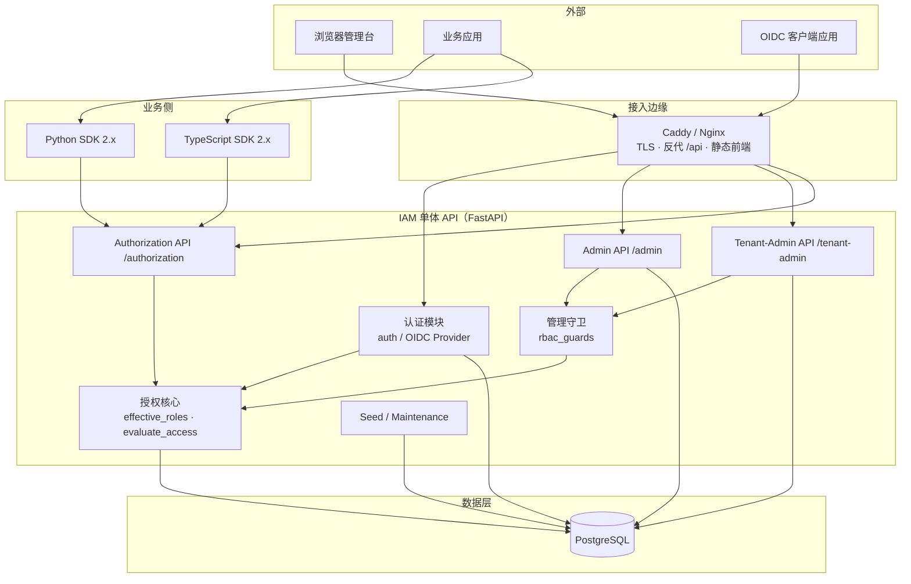
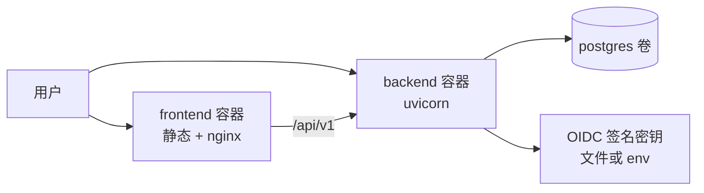
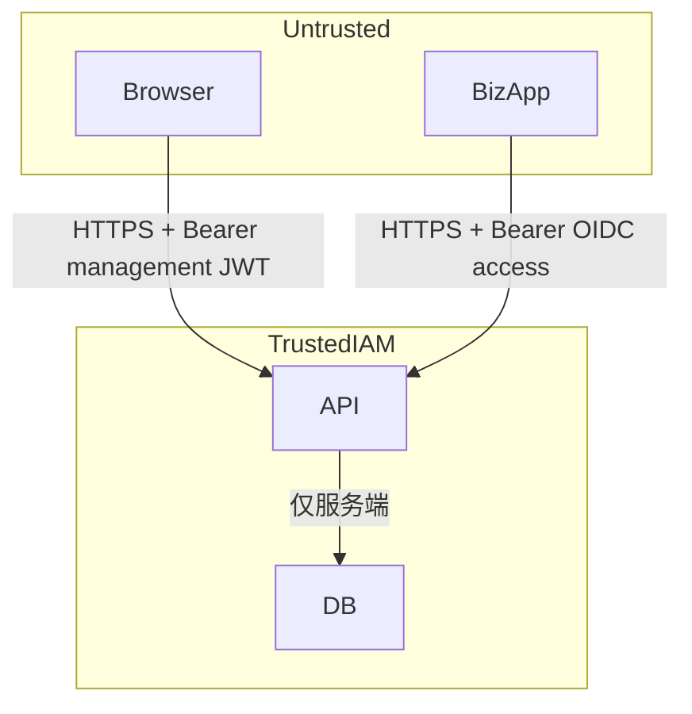

# 01 — 总体架构与模块边界

交叉引用：[00-overview](./00-overview.md) · [02-data-model](./02-data-model.md) · [03-authz-flow](./03-authz-flow.md)

---

## 1. 逻辑架构

## 2. 模块边界

| 模块 | 职责 | 不负责 |
|------|------|--------|
| **认证 AuthN** | 登录、刷新、OIDC 签发/吊销、密码哈希、会话 cookie | 细粒度业务授权结论（除入场「是否有有效角色」） |
| **有效角色** | Binding ∪ Group → Role 列表；唯一实现 | 数据范围解析 |
| **evaluate_access** | 权限码匹配、应用/资源钉死、数据范围、默认拒绝 | HTTP 状态码映射以外的业务 SQL |
| **rbac_guards** | 管理/租户 API 依赖注入式鉴权 | 前端菜单 |
| **Admin API** | 平台级资源 CRUD（租户、用户、目录、审计…） | 业务资源 CRUD |
| **Tenant-Admin API** | 本租户组织/成员/组/应用角色任命 | 开停租户、全局权限目录写 |
| **Authorization API** | 给业务的 check / check-batch | 管理台页面聚合（可用 capabilities） |
| **OIDC Provider** | 发现文档、授权、token、userinfo、revoke | 业务 IdP 联邦（若未来有，另模块） |
| **SDK** | 封装 check、owner_only、错误映射 | 持有客户端密钥长期逻辑以外的 IAM 管理 |

## 3. 部署视图（绿场默认）

- Compose：`api` + `postgres` + `frontend`（可与现 `compose.yaml` 对齐后简化）。  
- 无独立「策略引擎」进程（相对方案 B）。

## 4. 信任边界

- Body 中的 `tenant_id` / `application_id`：**OIDC 请求以 token 钉死为准**，不得被 body 抬权。  
- 管理 JWT **不**携带「全权限」声明；每次请求 live 查库。

## 5. 与现仓库目录映射

| 架构模块 | 目标路径（实施后） |
|----------|-------------------|
| 有效角色 | `backend/app/services/effective_roles.py`（新建） |
| 判定 | `backend/app/services/authorization.py` |
| 守卫 | `backend/app/services/rbac_guards.py`（新建） |
| Admin | `backend/app/api/v1/admin/*` |
| Tenant | `backend/app/api/v1/tenant_admin*.py` |
| OIDC | `backend/app/api/v1/oidc_provider/*` |
| Check | `backend/app/api/v1/authorization.py` |
| 种子 | `backend/app/db/seed_greenfield.py` |
| 前端壳 | `frontend/src/app/*` |
| SDK | `sdk/python/*`, `sdk/typescript/*` |

## 6. 关键决策记录（ADR 摘要）

| 决策 | 选择 | 理由 |
|------|------|------|
| 单体 vs 拆授权服务 | 保持 FastAPI 单体 | 绿场交付速度；团队熟悉 |
| 判定实现 | SQLAlchemy 实时查询 | 与现模型一致；无新组件 |
| 平台角色存放 | 专用平台租户 + `kind=platform` | 避免 NULL application 语义过载 |
| L3 任命 L2 | `iam.app_role.assign` 窄权限 | 互不包含前提下仍可运营 |
| 业务 data_scope | 默认强制 | 绿场可 breaking，一次做对 |
