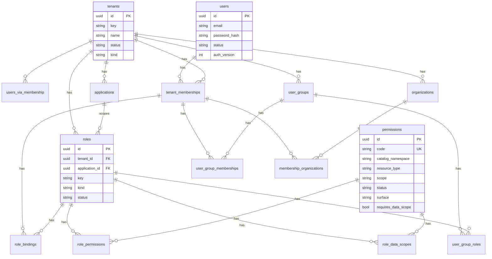

# 02 — 数据模型 / ER 与种子数据

交叉引用：[05-role-matrix](./05-role-matrix.md) · [09-bootstrap-ops](./09-bootstrap-ops.md)

---

## 1. ER 总图



## 2. 表字段级规格

### 2.1 `tenants`
| 字段 | 类型 | 约束 | 说明 |
|------|------|------|------|
| id | UUID | PK | |
| key | varchar(64) | unique | 平台种子：`platform` |
| name | varchar(120) | | |
| status | varchar(20) | active/disabled | |
| kind | varchar(20) | `system` \| `organization` \| `consumer` | 平台租户=`system` |

### 2.2 `users`
| 字段 | 类型 | 说明 |
|------|------|------|
| id | UUID PK | |
| email | citext/varchar unique | |
| password_hash | varchar | Argon2 |
| display_name | varchar | |
| status | active/disabled | |
| auth_version | int not null default 1 | 改密/全局停用 +1 |
| email_verified_at | timestamptz null | |

### 2.3 `tenant_memberships`
| 字段 | 类型 | 说明 |
|------|------|------|
| id | UUID PK | |
| user_id | UUID FK | |
| tenant_id | UUID FK | |
| status | active/disabled/departed | |
| auth_version | int not null default 1 | 绑定/组/范围等 +1 |
| unique | (user_id, tenant_id) | |

### 2.4 `permissions`
| 字段 | 类型 | 说明 |
|------|------|------|
| id | UUID PK | |
| code | varchar(180) unique | 如 `iam.tenant.manage` |
| catalog_namespace | varchar(100) | `iam` 或业务 ns |
| resource_type | varchar(100) | |
| scope | varchar(80) | 元数据，如 tenant/application |
| description | varchar(500) null | |
| status | active/disabled | |
| **surface** | management \| business | **绿场必有** |
| **requires_data_scope** | boolean not null default false | 业务码种子为 true |

### 2.5 `roles`
| 字段 | 类型 | 说明 |
|------|------|------|
| id | UUID PK | |
| tenant_id | UUID FK | 平台角色 → 平台租户 |
| application_id | UUID FK null | kind=application 时非空 |
| key | varchar(100) | `platform.super_admin` / `app.admin` / … |
| name | varchar(120) | |
| description | varchar(500) null | |
| status | active/disabled | |
| **kind** | platform \| tenant \| application | **绿场必有** |
| created_at | timestamptz | |

**唯一索引建议：**

- `(tenant_id, key) WHERE kind = 'tenant'`
- `(tenant_id, application_id, key) WHERE kind = 'application'`
- `(key) WHERE kind = 'platform'` 或 `(tenant_id, key) WHERE kind = 'platform'`

复合 FK：`(id, tenant_id)` 供 data_scope 使用（与现设计一致）。

### 2.6 `role_permissions`
| 字段 | 说明 |
|------|------|
| id, role_id, permission_id | |
| resource_id | varchar(180) null；可选钉死应用/资源 |

### 2.7 `role_bindings`
| 字段 | 说明 |
|------|------|
| id, membership_id, role_id | unique(membership_id, role_id) |
| created_at | |

### 2.8 `role_data_scopes`
| 字段 | 说明 |
|------|------|
| id, tenant_id, role_id, permission_id | unique(role_id, permission_id) |
| scope_type | tenant \| self \| organization \| organization_tree \| selected_organizations |
| organization_ids | JSON list | selected_* 时用 |

### 2.9 组与组织（摘要）
- `user_groups(id, tenant_id, key, name, status, …)`
- `user_group_memberships(group_id, membership_id, tenant_id)`
- `user_group_roles(group_id, role_id, tenant_id)`
- `organizations(id, tenant_id, parent_id, name, status, …)`
- `membership_organizations(membership_id, organization_id, tenant_id, is_primary)`

### 2.10 会话 / OIDC（保持能力，绿场可简化字段）
- `refresh_sessions`（管理台）含 `auth_version`, `revoked_at`, `expires_at`
- `revoked_access_tokens`（jti hash）
- `applications`：client_id, secret_hash, redirect_uris, permission_namespace, status, trusted, …
- `oauth_authorization_codes` / `oauth_refresh_tokens`：含 `auth_version`, `membership_version`

## 3. 种子数据设计

### 3.1 平台租户
```text
tenants: key=platform, kind=system, name=Platform, status=active
```

### 3.2 权限码
见 [05-role-matrix.md](./05-role-matrix.md) 全表；全部 `status=active`，management 码 `requires_data_scope=false`。

可选演示业务码（非必须）：
```text
demo.document.read / write
  surface=business, requires_data_scope=true, catalog_namespace=demo
```

### 3.3 角色模板
| key | kind | tenant | application | 权限 |
|-----|------|--------|-------------|------|
| platform.super_admin | platform | platform | null | 全部 management 码 |
| tenant.org_admin | tenant | （每业务租户一份，或全局模板 clone） | null | 见矩阵 L3 |
| app.admin | application | 随应用创建 clone | 该应用 | 见矩阵 L2 |
| app.member | application | 随应用创建 clone | 该应用 | 无 management；可选 demo 码 + data_scope=self |

**绿场策略：** 创建业务租户时自动 clone `tenant.org_admin`；创建应用时自动 clone `app.admin` + `app.member`。

### 3.4 Bootstrap 用户
```text
users: email=BOOTSTRAP_ADMIN_EMAIL, status=active
tenant_memberships: user × platform tenant, status=active
role_bindings: → platform.super_admin
```
可选：再加一个空业务租户 `acme` 便于手工验收（开关 `SEED_DEMO_TENANT=true`）。

### 3.5 种子幂等
- 按 `code` / `key` upsert；重复执行不造重复绑定。  
- 禁止 seed 删除用户数据以外的「清空」——清空只走 reset 脚本。

## 4. 迁移策略（绿场）

- 单一头文件：`0001_greenfield_iam.py` 建全表。  
- 旧 versions 归档。  
- 数据只来自 seed，无 data migration。
