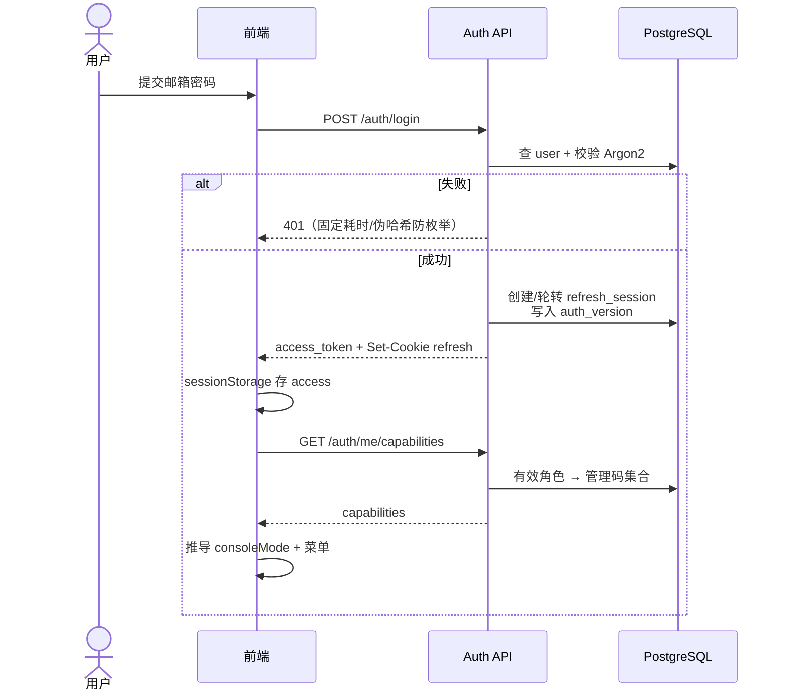
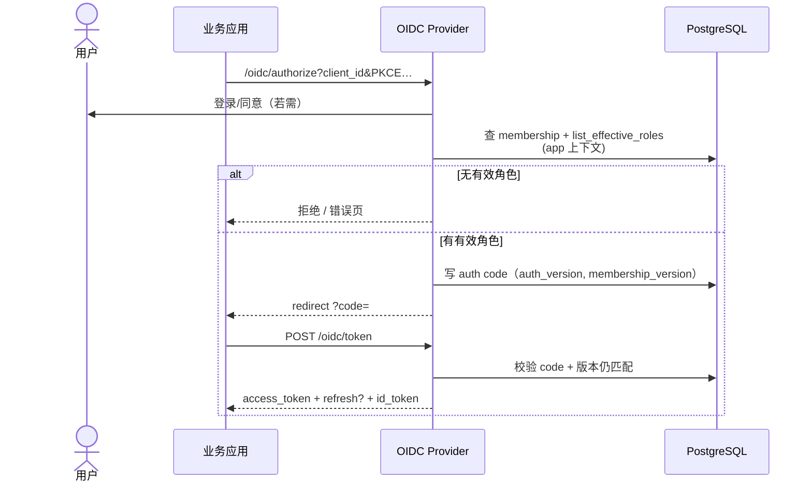
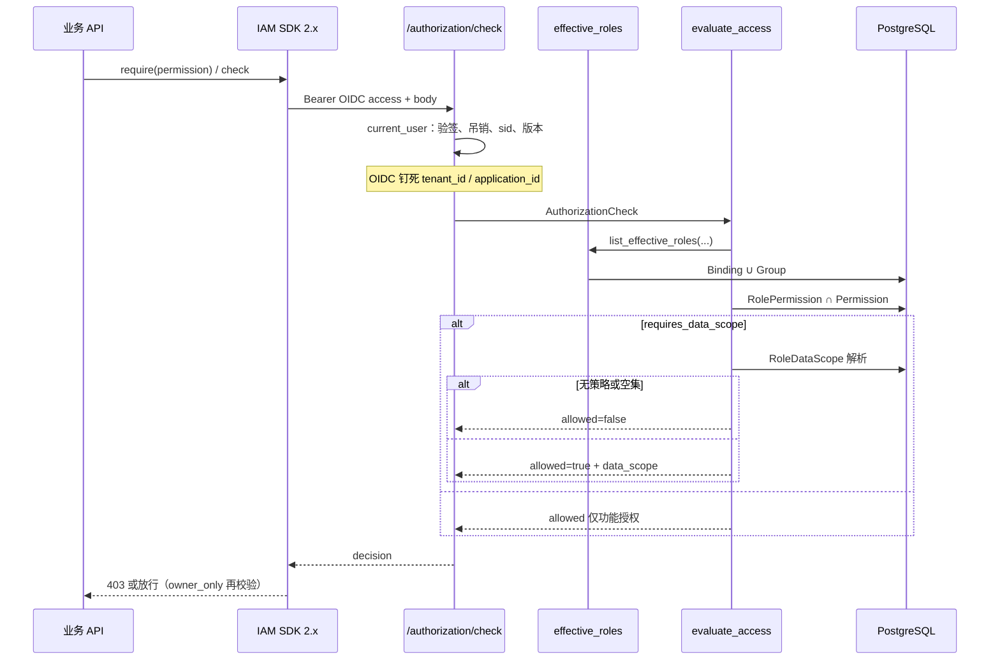
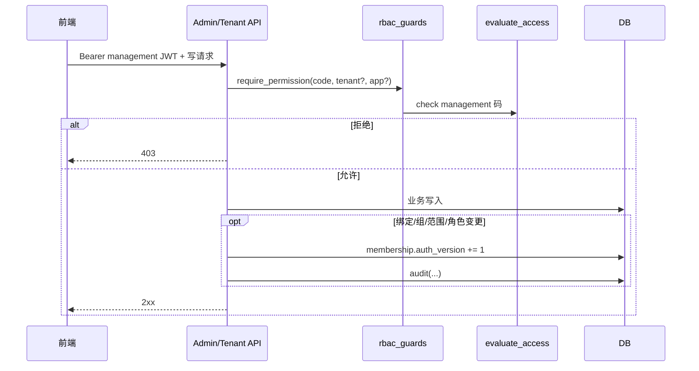
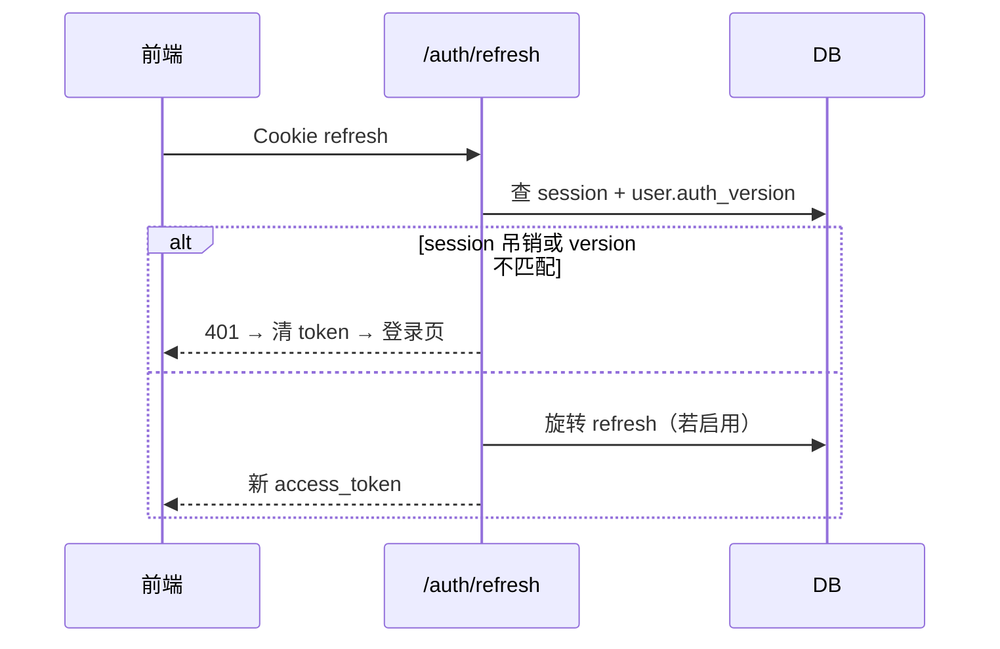

# 03 — 鉴权判定时序

交叉引用：[01-architecture](./01-architecture.md) · [04-api-design](./04-api-design.md) · [08-security](./08-security.md)

---

## 1. 管理台密码登录



**要点：** 登录成功 ≠ 平台超管；必须靠平台租户上 L1 绑定（或破窗，默认关）。

## 2. OIDC 授权码 + 入场



**入场判定：** `_app_membership` 使用与 `evaluate_access` 相同的有效角色（含组）；至少 1 个匹配该 `application_id` 或租户级可进应用的角色（`app.member` / `app.admin` 等）。

## 3. 业务 Authorization Check



## 4. 管理台 / 租户台写操作



**L1：** 平台租户上持有对应码（种子为全码）。  
**L2/L3：** 在业务租户 membership 上持有码；应用码钉 `application_id`。

## 5. Token 刷新与废票



OIDC refresh：比对 `auth_version` 与 `membership_version`；绑定变更后旧 refresh/access 失效。

## 6. 判定伪代码（规格级）

```text
function evaluate_access(body, user, db):
  assert user.active
  tenant_id, application_id = pin_from_oidc_or_body(user, body)
  assert tenant active
  membership = active membership(user, tenant_id) or deny
  roles = list_effective_roles(membership, tenant_id, application_id)
  grants = match(roles, body.permission_code, body.resource_id)
  if not grants: deny(no_matching_grant)
  perm = grants.permission
  need_scope = perm.requires_data_scope or body.include_data_scope
  if not need_scope: allow()
  policies = RoleDataScope for matched roles × perm
  if not policies: deny(data_scope_policy_missing)
  constraints = resolve(policies, membership orgs, …)
  if empty: deny(data_scope_resolves_to_empty)
  allow(data_scope=constraints)
```
