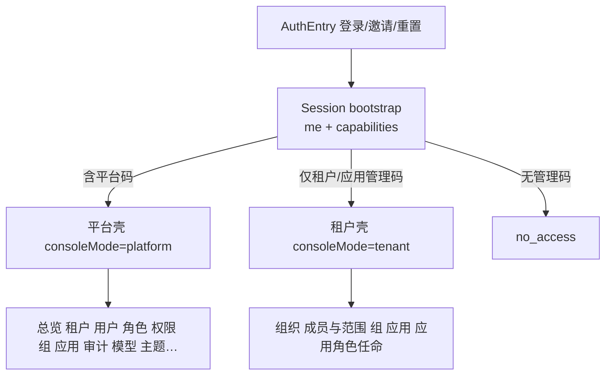

# 06 — 前端信息架构与路由守卫

交叉引用：[05-role-matrix](./05-role-matrix.md) · [04-api-design](./04-api-design.md)

技术栈保持：Vue 3 + Vue Router + Ant Design Vue + 现有 `frontend/src` 结构。

---

## 1. 信息架构



- **不再**用「`GET /admin/overview` 成功 ⇒ 全菜单」作为唯一信号。  
- 同时有平台码与租户码时：进入 **platform 壳**，租户相关页仍可用（L1 代管）；或顶栏提供「租户上下文」切换（可选增强，非首期必做）。

## 2. 导航配置

扩展 `navigation.ts`：

```ts
// 规格示意
type NavItem = {
  key: PageKey
  label: string
  path: string
  requiredPermissions: string[]  // any-of
  shell: 'platform' | 'tenant' | 'both'
}
```

示例见 [05 §4](./05-role-matrix.md)。  
`visibleNavigation = nav.filter(item => item.requiredPermissions.some(p => caps.has(p)))`。

## 3. Capabilities 客户端

新建 `shared/services/capabilities.ts`：

- `loadCapabilities()` → `GET /auth/me/capabilities`  
- 内存缓存；登出 / `iam:unauthorized` 清空  
- 导出：`has(code)`, `hasAny(codes[])`, `platformCodes`, `tenantCaps(tenantId)`  

`App.vue` 在 token 存在时 bootstrap：`me` → `loadCapabilities` → 设 `consoleMode` → `router.replace` 合法首页。

## 4. 路由守卫

`router.ts`：

```text
beforeEach:
  if 目标需要登录且无 token → AuthEntry / 登录
  if sessionBootstrapping → 等待
  if consoleMode == no_access 且目标不是无权限页 → /no-access
  if 目标 PageKey 不在 visibleNavigation → 重定向到 visible 首页或 /no-access
```

通配 `/:pathMatch(.*)*` → 有能力则首页，否则 no_access（避免旧逻辑一律 `/overview`）。

## 5. 页面级按钮

| 区域 | 规则 |
|------|------|
| 平台角色/权限写按钮 | `has('iam.role.manage')` 等 |
| 应用页 | `can_manage` / `can_rotate_secret` 来自 capabilities.applications[] |
| 组织/数据范围 | `iam.organization.manage` |
| 组 | `iam.group.manage` |
| L3「设为应用管理员」 | `iam.app_role.assign`；UI 文案勿写成「应用配置」 |

`api-prefix`：首期可保留 `/admin` vs `/tenant-admin` 双前缀，由 shell 决定；后端均按码校验。

## 6. 与现文件对照

| 现文件 | 改造点 |
|--------|--------|
| `app/App.vue` | bootstrap 改 capabilities；删 overview 唯一判定 |
| `app/navigation.ts` | requiredPermissions |
| `app/router.ts` | beforeEach |
| `features/groups/GroupManagement.vue` | tenant-admin 前缀 + 码 |
| `features/applications/*` | 对齐 L2 |
| `features/tenant-admin/*` | assign 入口 |
| `features/roles/*` `permissions/*` | 仅 L1 写 |

## 7. UX 文案

- no_access：「当前账号无控制台管理权限；如需管理请联系超级管理员或租户管理员。」  
- 403 Toast：展示后端 detail，不假装成功。  
