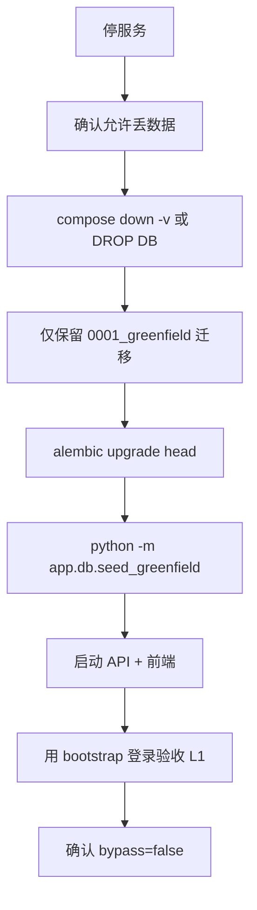

# 09 — 清库重建与部署运维

交叉引用：[02-data-model](./02-data-model.md) · [role-iam-plan-a-greenfield.md](./role-iam-plan-a-greenfield.md)

---

## 1. 绿场重置流程（本地 / 预发）

### 1.1 建议脚本行为 `scripts/greenfield-reset.ps1` / `.sh`

1. 打印警告：「将删除所有 IAM 数据与卷」；需 `--i-understand` 旗标。  
2. `docker compose down -v`（或文档化的 DB URL drop/create）。  
3. `alembic upgrade head`。  
4. `seed_greenfield`（读 `.env`：`BOOTSTRAP_ADMIN_EMAIL/PASSWORD`，可选 `SEED_DEMO_TENANT`）。  
5. 输出：登录 URL、bootstrap 邮箱、下一步打开验收清单。  

### 1.2 环境变量（绿场关键）

| 变量 | 默认 | 说明 |
|------|------|------|
| `BOOTSTRAP_ADMIN_EMAIL` | 必填（非空生产） | 种子 L1 |
| `BOOTSTRAP_ADMIN_PASSWORD` | 必填种子时 | 仅 seed 使用 |
| `ALLOW_BOOTSTRAP_EMAIL_BYPASS` | **false** | 运行时破窗 |
| `SEED_DEMO_TENANT` | false | 是否种 acme 演示 |
| `JWT_SECRET` | ≥32 | 管理 JWT |
| OIDC 密钥路径 | 按现配置 | |
| `DATABASE_URL` | | |
| `CORS_ORIGINS` | | |

## 2. 生产首次部署

1. 空库 + 0001 + seed（bootstrap 强密码）。  
2. 部署 API/前端；健康检查 `/health` `/ready`。  
3. 登录 L1 → **立即**创建备用 L1 用户并绑定 `platform.super_admin` → 再保管 bootstrap。  
4. 确认 bypass=false。  
5. 按业务清单重建应用与回调；分发 SDK 2.x。  
6. 配置备份：Postgres 定期快照；OIDC 私钥备份（离线）。

## 3. 日常运维

| 操作 | 谁 | 怎么 |
|------|----|------|
| 开租户 | L1 | admin tenants API/UI |
| 任命租户管理员 | L1 | 绑定 `tenant.org_admin` |
| 任命应用管理员 | L3 assign 或 L1/L2 | `app.admin` 绑定 |
| 轮换应用密钥 | L1/L2 | rotate-secret |
| 紧急回收 | L1 | unbind + 用户/成员停用（bump） |
| 破窗急救 | 运维改 env true→重启→绑 L1→改回 false | 审计检查 |

## 4. 迁移链治理

- 绿场后新变更继续增量 migration（0002…）。  
- `archive_pre_greenfield/` 不参与 alembic。  
- 禁止在生产对绿场库跑旧 0021–0031。

## 5. 监控与告警建议

- `/ready` 非 200  
- 登录失败率/throttle  
- 403 突增（配置错误）  
- 破窗开启告警（配置漂移）  
- OIDC token 签发失败率  

## 6. 回滚

绿场首次：回滚=再执行 reset（数据本就无旧资产）。  
后续增量：DB migration down（需各 revision 支持）+ 应用版本回滚；破窗仅作身份急救非代码回滚。
