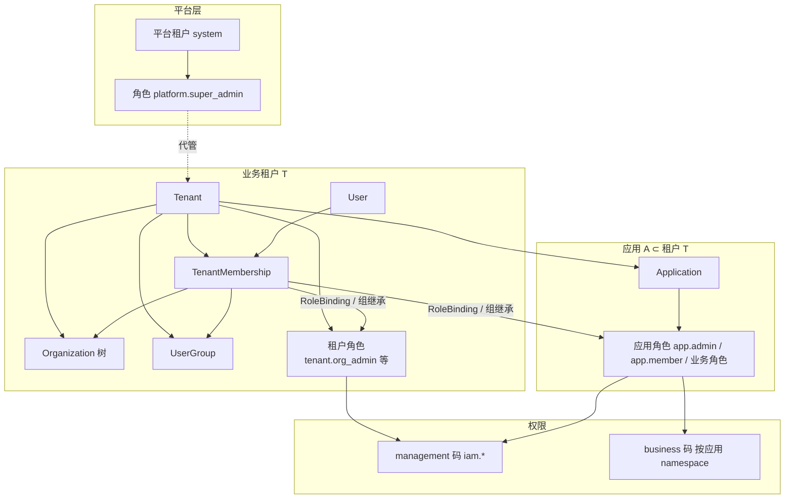

# 11 — 三图菜单定稿与关联模型可行性

> 依据用户侧栏截图三张 + 现仓库 `D:\project\role` 模型（`Organization.tenant_id`、`Application.tenant_id`、`Role.application_id` 可选等）。  
> 只出方案，不改代码。与 [05-role-matrix](./05-role-matrix.md)、[role-iam-plan-a-greenfield.md](./role-iam-plan-a-greenfield.md) 冲突时：**菜单以本稿截图为准**；**组织归属仍以「挂租户」修正结论为准**。

---

## 1. 三图菜单清单对照

以下按用户标注：图一=应用管理员，图二=超级管理员，图三=管理员。

### 1.1 逐项对照表

| # | 菜单 | 图二 超级管理员 | 图一 应用管理员 | 图三 管理员 | 现前端 PageKey（约） |
|---|------|:---------------:|:---------------:|:-----------:|----------------------|
| 1 | 工作台 | ✓ | ✗ | ✗ | `overview` |
| 2 | 租户管理 | ✓（截图选中） | ✗ | ✗ | `tenants` |
| 3 | 应用管理 | ✓ | ✓ | ✗ | `applications` |
| 4 | 新项目接入 | ✓ | ✓ | ✗ | `project_integration` |
| 5 | 用户管理 | ✓ | ✓ | ✓ | `users` |
| 6 | 成员邀请 | ✓ | ✓ | ✓ | `invitations` |
| 7 | 用户组 | ✓ | ✓ | ✓ | `groups` |
| 8 | 组织管理 | ✓ | ✓ | ✓ | `organizations` |
| 9 | 角色管理 | ✓ | ✓ | ✓ | `roles` / `application_roles` |
| 10 | 权限目录 | ✓ | ✓ | ✓ | `permissions` |
| 11 | 授权模拟 | ✓ | ✓ | ✓ | `authorization_simulation` |
| 12 | 模型管理 | ✓ | ✓ | ✓ | `models` |
| 13 | 模型用量 | ✓ | ✓ | ✓ | `model_usage` |
| 14 | 登录主题 | ✓ | ✓ | ✗ | `themes` |
| 15 | 审计日志 | ✓ | ✓ | ✗ | `audit` |
| — | **合计** | **15** | **13** | **9** | |

### 1.2 差集（产品含义）

```text
超级管理员 − 应用管理员 = { 工作台, 租户管理 }
应用管理员 − 管理员     = { 应用管理, 新项目接入, 登录主题, 审计日志 }
管理员                   = 人治 + RBAC 配置 + 模型读写（无开租户、无管应用壳、无主题、无审计）
用户（无图）             = 无上述管理台菜单；仅业务应用内权限
```

### 1.3 与此前「L2 只管单应用配置」叙述的差异

截图中的 **应用管理员** 远大于「仅 `iam.application.*`」：含用户/组织/角色/权限目录/模拟/模型/主题/审计。  
定稿时以 **截图菜单 = 产品真相**；权限码映射见 §4，不再沿用「L2 只有应用四件套」的窄定义（除非产品改口收回菜单）。

---

## 2. 与现有模型差距

### 2.1 现码真实挂载（摘自模型）

| 实体 | 外键/归属 | 含义 |
|------|-----------|------|
| `applications` | **`tenant_id`** | 应用属于租户 |
| `organizations` | **`tenant_id`**（树在租户内） | **组织不属于应用** |
| `tenant_memberships` | `user_id` + `tenant_id` | 用户先加入租户 |
| `membership_organizations` | membership + organization（同租户） | 用户挂组织，仍在租户 |
| `user_groups` | **`tenant_id`** | 组在租户 |
| `roles` | `tenant_id` + 可选 **`application_id`** | 租户角色或应用角色 |
| `permissions` | **全局目录**（`code` unique） | 不按应用分表 |
| `role_bindings` | 挂在 **membership** | 授权主体是「租户成员」 |
| `role_data_scopes` | 角色×权限 → 组织/本人等 | 数据范围按**租户内组织**解析 |

前端现状：`NAV_ITEMS` 已接近图二全集；租户壳 `TENANT_NAV_ITEMS` 仍是「组织 / 成员与数据范围 / 应用 / 应用角色」，**小于**图三，更小于图一。

### 2.2 用户期望关联 vs 现码

| 期望 | 现码 | 差距 |
|------|------|------|
| 应用 → 组织架 → 用户 | 租户 → 组织 → 用户；应用并行挂租户 | **主链不一致** |
| 应用 → 角色 → 权限 | 已有 `Role.application_id` + `RolePermission` → `Permission` | **基本已具备**（权限目录仍全局） |
| 三级菜单分权 | 曾靠邮箱超管 / 租户少量码；绿场草案按码裁剪 | 菜单集合需按三图重绑码 |
| 用户 = 按应用分配业务权限 | OIDC 应用上下文 + 应用角色/业务码 | **方向正确**，需与管理面菜单隔离 |

---

## 3. 可行性结论

### 3.1「应用 → 角色 → 权限」

**结论：可以（推荐保留并做强）。**

理由：

- 现模型已支持应用级角色（`application_id NOT NULL`）与角色授权限。  
- OIDC 按 `client_id` 钉死应用，check 可限制在应用角色。  
- 权限目录可继续全局，用 `catalog_namespace` / 应用 namespace 隔离业务码；管理码 `iam.*` 与业务码分 `surface`。

注意：图一/图三都出现「权限目录」「角色管理」——若开放**写全局目录**给应用管理员，等于抬升为近平台能力。应拆成：

- **读**：可看本应用 namespace相关权限  
- **写全局目录 / 停用全局码**：仅超级管理员  

（菜单可仍显示「权限目录」，后端写接口仅 L1。）

### 3.2「应用 → 组织架 → 用户」

**结论：不行（作为主归属链）；部分可以（作为「应用视角过滤」）。**

**不行的理由（结合现码）：**

1. **表结构**：`organizations.tenant_id` 强制组织属租户；无 `application_id`。改为属应用需推翻组织树、成员组织、`RoleDataScope` 解析与大量 API。  
2. **一租户多应用**：同一公司多个 OIDC 应用若各建一套组织树，用户与部门重复、跨应用授权与「组织树数据范围」失真。  
3. **成员模型**：用户通过 `tenant_memberships` 进租户，再挂组织；不是「先进应用再进组织」。OIDC 也是租户成员 + 应用角色。  
4. **数据范围**：`organization` / `organization_tree` 在 `evaluate_access` 中按**租户内**组织展开；挂到应用后语义与现 SDK/业务约定冲突。

**部分可以的做法（推荐）：**

- 主数据仍：**租户 → 组织 → 用户（成员）**。  
- 应用管理员进入「组织/用户」菜单时，**默认带当前应用上下文**（只管理「可使用本应用」的成员/组，或只展示与本应用角色有关的人）——这是 **视图/授权过滤**，不是把组织 FK 改到应用。

### 3.3 总判

| 命题 | 结论 |
|------|------|
| 三图作为三级管理菜单 | **可以**（产品定稿） |
| 应用→角色→权限 | **可以** |
| 应用→组织→用户（所有权） | **不行**，需修正为租户→组织→用户 |
| 用户按应用授业务权 | **可以** |

---

## 4. 推荐目标关联模型

### 4.1 主关系（修正后）



### 4.2 各实体挂哪一层（写死）

| 实体 | 挂载层 | 说明 |
|------|--------|------|
| 租户 Tenant | 顶层业务隔离 | 超级管理员可 CRUD |
| 应用 Application | **租户下** | 非组织下 |
| 组织 Organization | **租户下** | 非应用下 |
| 用户 User | 全局账号 | 通过 membership 进租户 |
| 用户↔组织 | 租户成员上 | `membership_organizations` |
| 用户组 | 租户下 | 可赋租户角色或应用角色 |
| 角色 | 租户角色 **或** 应用角色 | `kind` + `application_id` |
| 权限 | 全局目录 | 业务码用 namespace 归属应用；授予经角色 |
| 数据范围 | 角色×权限 | 组织范围指**租户组织树** |

### 4.3 两条产品链（对外话术）

1. **人治链（修正）：** `租户 → 组织架 → 用户（成员）`；应用管理员/管理员在此链上操作，但数据属租户。  
2. **授权链（保留）：** `应用 → 角色 → 权限（业务码）`；用户经绑定/组获得应用角色后，OIDC 进该应用。

可选第三链（管理授权）：`租户 → 租户角色 → 管理码`（管理员、部分应用管理员能力）。

### 4.4 四级 × 菜单 × 权限码（按三图终稿）

> 读写拆分：菜单「可见」用 read；页内写按钮用 manage。下列为**建议最小码集**。

#### 超级管理员（图二全部 15 项）= L1 `platform.super_admin`

| 菜单 | 可见/操作码 |
|------|-------------|
| 工作台 | `iam.platform.overview.read` |
| 租户管理 | `iam.tenant.read` / `manage` |
| 应用管理 | `iam.application.*`（全租户） |
| 新项目接入 | `iam.application.read|manage` |
| 用户管理 | `iam.user.read|manage` |
| 成员邀请 | `iam.invitation.manage` |
| 用户组 | `iam.group.*` |
| 组织管理 | `iam.organization.*` |
| 角色管理 | `iam.role.*` + `iam.app_role.*` |
| 权限目录 | `iam.permission.read|manage`（**含写全局**） |
| 授权模拟 | `iam.authorization.simulate` |
| 模型管理/用量 | `iam.model.read|manage` |
| 登录主题 | `iam.theme.manage` |
| 审计日志 | `iam.audit.read` |

种子：上表全部 management 码。

#### 应用管理员（图一 13 项）= L2 `app.admin`（**加宽后的产品定义**）

作用域：默认钉在 **应用 A**，人治数据在 **租户 T=A.tenant_id** 内；**不能**开停租户、不能看工作台总览（或仅应用级概览——截图无则不做）。

| 菜单 | 码（建议） | 范围约束 |
|------|------------|----------|
| 应用管理 | `iam.application.read|manage` + 可选 `secret.rotate` | **仅 A** |
| 新项目接入 | 同上（只读本应用接入说明） | 仅 A |
| 用户管理 | `iam.member.read|manage` 或收窄的 `iam.user.read`（仅本租户） | 租户 T；推荐只展示持有 A 角色的成员 |
| 成员邀请 | `iam.invitation.manage` | 邀请进 T，并可预绑 A 角色 |
| 用户组 | `iam.group.*` | 租户 T；组角色限与 A 相关 |
| 组织管理 | `iam.organization.*` | 租户 T |
| 角色管理 | `iam.app_role.read|manage` | **仅 A 的应用角色**；不可改平台/他应用角色 |
| 权限目录 | `iam.permission.read` | **只读**；写全局 ✗ |
| 授权模拟 | `iam.authorization.simulate` | 模拟对象限 T，应用上下文钉 A |
| 模型管理/用量 | `iam.model.read`（± manage） | 建议限 T 或与 A 关联的用量 |
| 登录主题 | `iam.theme.manage` | **仅 A** |
| 审计日志 | `iam.audit.read` | 建议过滤 T/A 资源；全站审计仍可仅 L1 |

**显式禁止：** `iam.tenant.manage`、`iam.platform.overview.read`、`iam.permission.manage`。

#### 管理员（图三 9 项）= L3 `tenant.org_admin`

| 菜单 | 码 | 约束 |
|------|-----|------|
| 用户管理 | `iam.member.read|manage` | 租户 T（无全局用户目录也可） |
| 成员邀请 | `iam.invitation.manage` | T |
| 用户组 | `iam.group.*` | T |
| 组织管理 | `iam.organization.*` | T |
| 角色管理 | `iam.app_role.assign` + 只读租户内角色列表 | **可任命 app.admin，不可改应用配置/密钥**；不可管平台角色 |
| 权限目录 | `iam.permission.read` | 只读 |
| 授权模拟 | `iam.authorization.simulate` | 限 T |
| 模型管理/用量 | `iam.model.read`（±） | 限 T |

**显式禁止：** 租户开通、应用管理/接入、登录主题、审计（与截图一致）、`secret.rotate`、全局权限写。

#### 用户 = L4

- 无管理台菜单（`no_access`）。  
- 由 **应用角色 → 业务权限码**（`surface=business`）授权；OIDC 进具体应用；数据范围默认强制。

---

## 5. 对用户原设计的修正关联

### 5.1 不要采用的主链

```text
✗ 应用 → 组织架 → 用户   （所有权）
✗ 组织.application_id 替代 tenant_id
```

### 5.2 采用的主链

```text
✓ 租户 → 组织架 → 用户（成员）
✓ 租户 → 应用
✓ 应用 → 角色 → 权限（业务 + 应用管理码）
✓ 租户 → 角色 → 权限（租户管理码，如 L3）
✓ 用户通过「租户成员」绑定/组继承获得角色
```

### 5.3 为何图一仍能出现「组织/用户」

应用管理员 **不是**「组织属于应用」，而是：

- 被授予租户 T 内的人治管理码，且  
- UI/API **强制应用上下文 A**（只管与 A 相关的角色任命、主题、接入；组织树仍是公司级共享）。

若业务强要求「每个应用独立部门树」，应升为 **一应用一租户**（租户=应用隔离单元），而不是组织挂应用——那是产品 isolation 级别选择，需另立项目。

### 5.4 角色分层纠正（相对早期窄 L2）

| 角色 | 菜单来源 | 数据范围 |
|------|----------|----------|
| 超级管理员 | 图二 | 全站 |
| 应用管理员 | 图一 | 单应用 + 其所属租户之人治（受约束） |
| 管理员 | 图三 | 单租户人治 + 任命应用管理员 |
| 用户 | 无图 | 单应用业务权限 |

L2 与 L3 **仍互不「角色包含」**：L3 无应用管理/主题/审计；L2 无租户开通；二者菜单差集即边界。

---

## 6. 改造要点（绿场可清数据）

1. **模型不改组织归属**：保持 `Organization.tenant_id`；不建 `organization.application_id` 主链。  
2. **角色 kind 三分**：platform / tenant / application；种子 L1/L2/L3/L4 按 §4 授码（L2 码集按图一加宽）。  
3. **菜单配置**：`navigation.ts` 按三图 `requiredPermissions` 裁剪；删掉与图不符的「租户壳只有 4 项」假设，改为 **同一导航表 + 能力过滤**（更贴三图）。  
4. **API 范围过滤器**：凡 L2 调用户/组/组织/审计，强制 `tenant_id = app.tenant_id`，应用写接口强制 `application_id = A`。  
5. **权限目录写死**：L2/L3 仅 read；L1 可 manage。菜单可都显示。  
6. **角色管理页拆标签**：租户角色 vs 本应用角色；L2 只写应用角色；L3 以「任命 app.admin」为主。  
7. **用户**：仅业务角色；管理台 no_access。  
8. **清库种子**：按三图验收菜单可见性（自动化：caps → visible nav keys）。  
9. **文档**：更新 05/06 矩阵与前端 IA，注明「组织挂租户；应用→角色→权限」。

### 6.1 验收（菜单）

| 角色 | 可见菜单集合必须等于 |
|------|----------------------|
| L1 | 图二 15 项 |
| L2 | 图一 13 项 |
| L3 | 图三 9 项 |
| L4 | 空 |

另验：L2 无法 `tenant.manage`；L3 无法 `application.manage` / `theme` / `audit`；L2/L3 无法 `permission.manage`。

---

## 7. 结论摘要

- 三图可作为三级管理员菜单终稿。  
- **应用→角色→权限：可以。**  
- **应用→组织→用户：不能做主模型**；改为 **租户→组织→用户**，应用管理员用人治码 + 应用上下文过滤。  
- 绿场下最小清晰设计：清数据、种子三级管理角色按图授码、组织仍属租户、导航按能力裁剪、目录写权限仅超管。
