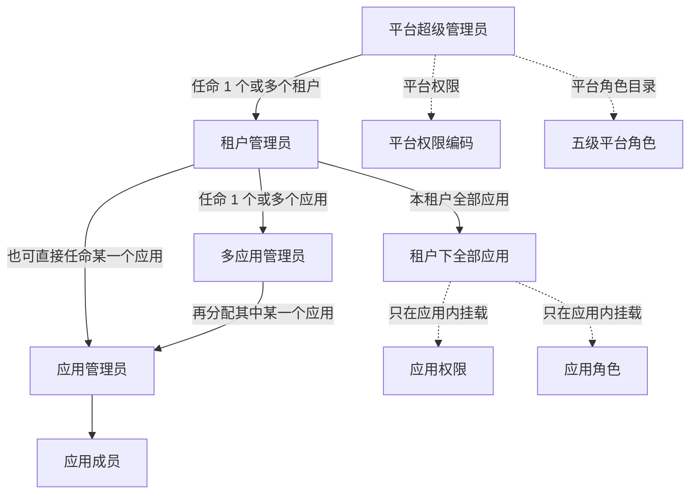
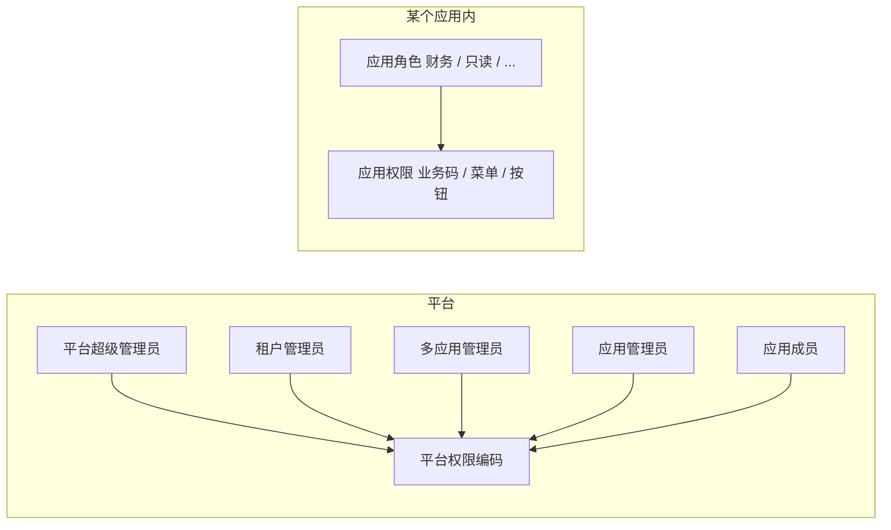

# 平台权限 / 应用权限分层（P405 现网口径）

> **状态：** P405 已落地为现网口径。  
> **日期：** 2026-10-29 Asia/Shanghai  
> PRD §3.1、配权说明书与代码已按本文改完。不跑 `--更新` 全量审计，无迁移，无 DeerFlow。

---

## 1. 一句话

平台管平台，应用管应用。

**平台角色**只管平台的事：谁能进管理台、看见哪些租户 / 应用、能不能建应用、能不能任命下级。五级平台角色是：平台超级管理员、租户管理员、多应用管理员、应用管理员、应用成员。

**应用角色**钉在某个应用上：可挂该应用业务码 / 菜单 / 按钮，以及操作者看得见的租户 / 应用管理码。禁止把五级平台模板当成应用角色。

---

## 2. 两套权限，不许混

| | **平台权限** | **应用权限** |
|---|---|---|
| 管什么 | IAM 管理台自己：租户、组织、用户、邀请、平台角色任命、审计、主题、模型账本等 | 某个业务应用里：业务码、菜单、按钮、数据规则 |
| 挂在哪 | 平台权限编码目录（高级管理） | **只挂在该应用内**（应用工作台：权限 / 资源树） |
| 谁 CRUD | 平台超级管理员全量；下级按任命范围只读或有限配置，**看不见也改不了平台专属码** | 租户管理员：本租户全部应用；多应用 / 应用管理员：仅被授权的应用 |
| 挂给谁 | **只挂给平台角色** | **挂给该应用的应用角色** |
| 禁止 | 把 `demo.document.read` 这类业务码登记进平台目录 / 挂给平台角色 | 挂外应用业务码；挂操作者看不见的管理码（L1 专属码下级不可见） |

「平台租户对应的权限分配」按口述整理为：

- 租户管理员可以配 **本租户的平台侧能力**（组织、成员、用户组、邀请、本租户应用生命周期）。
- 租户管理员 **不是** 去改全平台专属码（例如全站租户目录、平台账号治理）。
- 应用侧的菜单 / 按钮 / 业务码仍只在应用里配，只挂给应用角色。

目标界面：

- **高级管理 → 权限编码**：只出现平台权限。
- **高级管理 → 角色**：平台角色（系统五级模板 + 本范围内自定义平台角色）。
- **应用工作台**：只出现该应用的业务码、**应用角色**（含自定义）、菜单、按钮。两边列表互不掺入。

---

## 3. 两类角色，不许混

角色按「管平台还是管应用」切开。**不要再按现网 `kind=platform/tenant/application` 理解成三类产品角色。** 租户管理员、多应用管理员、应用管理员、应用成员都是平台角色，只是可见范围不同。

| | **平台角色** | **应用角色** |
|---|---|---|
| 管什么 | 平台的事：管理台可见范围、任命、租户 / 应用生命周期、组织成员组邀请 | 应用的事：该应用业务功能、菜单、按钮、数据规则 |
| 有哪些 | 系统预置五级模板：平台超级管理员、租户管理员、多应用管理员、应用管理员、应用成员。另外，前四级管理员可在自己可见范围内 **新建自定义平台角色** | 该应用内自定义（如财务、只读、运营）。每个应用自己的一份，互不共用。前四级管理员可在可见应用内 **新建应用角色** |
| 挂什么 | **只挂平台权限** | **只挂应用权限**（业务码 / 菜单 / 按钮） |
| 出现在哪 | 高级管理 → 角色 | **只在该应用工作台** |
| 禁止 | 挂业务码 / 菜单 / 按钮 | 挂平台权限；也不能拿去当平台管理员 |

五级平台角色各自控制 **对应范围的平台权限**：

| 平台角色 | 平台权限范围（摘要） |
|---|---|
| 平台超级管理员 | 全平台：所有租户、所有应用、平台权限编码、任命租户管理员 |
| 租户管理员 | 被任命租户内的平台能力：组织 / 成员 / 组 / 邀请、本租户应用生命周期、任命多应用 / 应用管理员 |
| 多应用管理员 | 被授权的那几个应用对应的平台能力（应用配置、密钥、该应用下的平台角色成员）；不能建删应用 / 租户 |
| 应用管理员 | 某一个应用对应的平台能力；可维护该应用成员与应用内配权入口 |
| 应用成员 | 平台侧只表示「属于该应用」；不进管理台配权（或仅只读与自己相关的信息），不持有平台管理码 |

应用角色不管平台：

- 财务、只读、运营这类名字只存在于某个应用内。
- 它们决定业务前端能看见哪些菜单、哪些按钮，**不决定**能不能进 IAM 管理台、能不能看见别的租户。
- 业务前端仍用应用角色拿到的资源树渲染菜单和按钮（现网第 ③ 层应用资源树保留）。

同一人可以同时持有平台角色和应用角色。例如：是租户 A 的租户管理员（平台角色），同时又是某应用里的「财务」（应用角色）。可见范围按身份并集，**互不串租户、互不串应用**。

### 3.1 新建角色：看得见才能配

平台超级管理员、租户管理员、多应用管理员、应用管理员 **都可以新建角色**。角色上的权限 **可以自由搭配**。硬约束只有一条：

**看不见的就不能配。** 目录里不出现自己没有的权限，也配不进去。

| 谁新建 | 能建什么 | 勾选权限时能看见什么 |
|---|---|---|
| 平台超级管理员 | 全平台的自定义平台角色；任意应用的应用角色 | 全部平台权限 + 对应应用的全部应用权限 |
| 租户管理员 | 本租户范围内的自定义平台角色；本租户各应用的应用角色 | 自己已有的平台权限 ∩ 本租户范围；本租户应用的应用权限 |
| 多应用管理员 | 被授权应用内的角色（自定义平台角色若与这些应用相关，也限这些应用；应用角色只限这些应用） | 自己已有的权限 ∩ 被授权的那些应用 |
| 应用管理员 | 仅该应用内的角色 | 自己已有的权限 ∩ 这一个应用 |
| 应用成员 | **不能** 新建角色 | 不进管理台配权 |

补充约定：

- 自由搭配 **不等于** 跨类混挂。平台角色仍然只挂平台权限，应用角色仍然只挂应用权限。
- 自由搭配 **不等于** 提权。租户管理员不能勾到「新建租户」这类自己没有的平台专属码；应用管理员不能勾到其他应用的码，也不能勾到租户级组织 / 成员管理码。
- 系统预置五级平台角色仍在，用来当任命台阶。自定义角色是额外的，权限从创建人看得见的集合里勾，可多可少。
- 应用成员不在「可新建角色」名单里。

---

## 4. 五级平台角色与可见范围

这五级都是 **平台角色**。下面的「看见 / 能做」指平台侧能力。他们要给某个应用配菜单 / 按钮时，是进入该应用工作台，去改 **应用角色**，不是给自己的平台角色挂业务码。

### 4.1 平台超级管理员

- **看见：** 所有租户 → 每个租户下所有应用 → 应用下的管理员 → 管理员下的成员。
- **能做：** 平台权限与应用权限的全部增删查改；创建 / 停用 / 删除租户；创建 / 删除应用；**新建角色，权限自由搭配**（全目录可见）。
- **任命：** 把某个用户设为 **一个或多个租户** 的租户管理员。

### 4.2 租户管理员（可同时管多个租户）

- **看见：** 仅被任命的那些租户，以及这些租户下的 **全部应用**。
- **不能：** 看见别的租户；**新增租户、删除租户**。
- **能做：** 管理本租户全部应用（含进入应用工作台配应用角色）；在本租户配组织 / 成员 / 组 / 邀请等平台侧能力；任命 **多应用管理员**（给 1 个或多个应用）；也可以 **直接任命应用管理员**（只给某一个应用）；**新建角色，权限自由搭配**（只能看见、配置自己已有且属于本租户的权限）。
- **创建 / 删除应用：** **可以** 创建 / 删除本租户应用。多应用管理员、应用管理员不可以。

### 4.3 多应用管理员

- **来源：** 租户管理员授予 **一个或多个** 应用的管理权（任命链上的独立台阶）。
- **看见：** 只看见租户划给自己的那些应用，以及这些应用对应的平台侧能力（例如该应用的配置、密钥轮换、该应用平台角色成员）。
- **不能：** 看见同租户其他应用；**不能新建应用、不能删除应用、不能新建 / 删除租户**。
- **能做：** 在被授权的每个应用内配应用角色 / 菜单 / 按钮；把其中 **某一个应用** 再交给「应用管理员」；**新建角色，权限自由搭配**（只能看见、配置自己已有且属于这些应用的权限）。

### 4.4 应用管理员

此前口径里的「单应用管理员」与本角色是同一个。

- **来源：** 多应用管理员把其中某一个应用再交给此人；**租户管理员也可以直接任命**（只给某一个应用）。两种任命路径都有效。
- **看见 / 能做：** 仅该应用对应的平台能力，以及该应用内的应用角色、成员、菜单、按钮；**新建角色，权限自由搭配**（只能看见、配置自己已有且属于该应用的权限）。
- **不能：** 看见其他应用；不能新建应用。

### 4.5 应用成员

- 平台侧身份：属于该应用，可使用业务系统。
- 不进管理台配权（或仅看到与自己相关的只读信息）。
- 不持有平台管理码。
- 在该应用里具体能点哪些菜单 / 按钮，由 **应用角色** 决定，不由这个平台角色决定。

---

## 5. 日常配权路径（目标）

1. **平台超管：** 建租户、建应用（或授权租户管理员建应用）→ 登记平台权限编码 → 任命租户管理员（平台角色）；也可新建自定义角色，权限从全目录自由搭配。
2. **租户管理员：** 在本租户管组织 / 成员（平台）→ 打开某个应用，在应用内登记业务码、新建应用角色、勾选菜单 / 按钮（应用）→ 把 1 个或多个应用交给多应用管理员；也可以直接任命某个应用的应用管理员。新建角色时只能勾自己已有、且属于本租户的权限。
3. **多应用管理员：** 只在被授权应用内继续新建 / 配应用角色 / 菜单 / 按钮（权限自由搭配，仍看不见未授权应用）→ 需要时把其中 1 个应用再交给应用管理员。
4. **应用管理员：** 只维护这一个应用：可新建角色、自由搭配该应用内自己已有的权限；维护成员与可见菜单 / 按钮。
5. **应用成员：** 用业务系统；持有的应用角色决定菜单和按钮。

---

## 6. 能力对照（审稿用）

下表是 **平台角色** 的平台侧能力。应用内菜单 / 按钮另走应用角色，不写进这张表的「持有码」。

| 动作 | 平台超管 | 租户管理员 | 多应用管理员 | 应用管理员 | 应用成员 |
|---|---|---|---|---|---|
| 看见全部租户 | 是 | 否（仅被任命租户） | 否 | 否 | 否 |
| 新建 / 删除租户 | 是 | 否 | 否 | 否 | 否 |
| 看见本租户全部应用 | 是 | 是 | 否（仅被授权应用） | 否（仅 1 个应用） | 否（仅所属应用） |
| 新建 / 删除应用 | 是 | 是（本租户） | 否 | 否 | 否 |
| 改平台权限编码目录 | 是 | 否 | 否 | 否 | 否 |
| 配本租户组织 / 成员 / 组 | 是 | 是 | 否 | 否 | 否 |
| 在应用内登记业务码 / 应用角色 / 菜单按钮 | 是 | 本租户全部应用 | 被授权的那些应用 | 仅该应用 | 否 |
| 任命租户管理员 | 是 | 否 | 否 | 否 | 否 |
| 任命多应用管理员 | 是 | 是 | 否 | 否 | 否 |
| 任命应用管理员 | 是 | 是（可直接任命） | 是（只能把已有应用再交下去） | 否 | 否 |
| 新建角色（权限自由搭配） | 是（全目录） | 是（仅自己已有 ∩ 本租户） | 是（仅自己已有 ∩ 被授权应用） | 是（仅自己已有 ∩ 该应用） | 否 |

---

## 7. 与 P404 的差异（已在 P405 改掉）

1. 新增独立平台角色模板 `apps.admin`（多应用管理员）。管 N 个应用 = 绑 N 次；可任命该应用的 `app.admin`。
2. `GET /admin/permissions` 只出管理面码；业务码只走应用工作台。
3. 高级管理「平台角色」只出平台角色；工作台角色列表只出自定义应用角色。「应用角色与成员」独立页已下线，成员与应用权限都在工作台角色行配置。
4. 五级模板都是平台角色（库表 `kind` 仍可能是 application，产品分类看模板 key）。
5. 去掉 P383「自定义角色不能含授权权码」；改为看得见才能配。给平台成员分配应用角色时自动补 `app.member`。

---

## 8. 已确认（2026-10-29 审稿）

1. 租户管理员 **可以** 创建 / 删除本租户应用。
2. 多应用管理员是任命链上的独立台阶（租户管理员任命，给 1 个或多个应用）。应用管理员 **既可以由多应用管理员任命，也可以由租户管理员直接任命**。
3. 多应用管理员 **可以** 任命应用管理员（只能把自己已有的某一个应用交下去）。
4. 同一人同时是租户 A 的租户管理员、租户 B 的应用管理员——**允许**。可见范围按身份并集，互不串租户。
5. **角色只分两类：平台角色 / 应用角色。** 平台角色含五级系统模板（平台超级管理员、租户管理员、多应用管理员、应用管理员、应用成员），只挂平台权限。应用角色钉在应用上，可挂本应用业务码，以及操作者看得见的租户 / 应用管理码。不要把这五级当成应用角色。
6. **平台超级管理员、租户管理员、多应用管理员、应用管理员都可以新建角色，权限自由搭配。** 只能看见、配置自己已有权限范围内的东西。四个管理员都可改本级及以下系统预置角色的授权，不能改上级预置角色，也不能挂自己没有的上级码。平台角色仍拒业务码。应用成员不能新建角色。
7. **应用角色只在应用工作台配置。** 角色行「应用权限」含资源权限（权限编码 + 资源树）与数据权限（原数据范围）；「配置成员」按邮箱绑定，自动补 `app.member`。

---

## 9. 明确不做

- 不新建表 / 不跑 Alembic（`apps.admin` 仍钉 `application_id`）。
- 不把 DB `kind` 从三级改成产品两类。
- 不迁移、不做 DeerFlow、不上线包（MFA / 注销 / 配额）。
