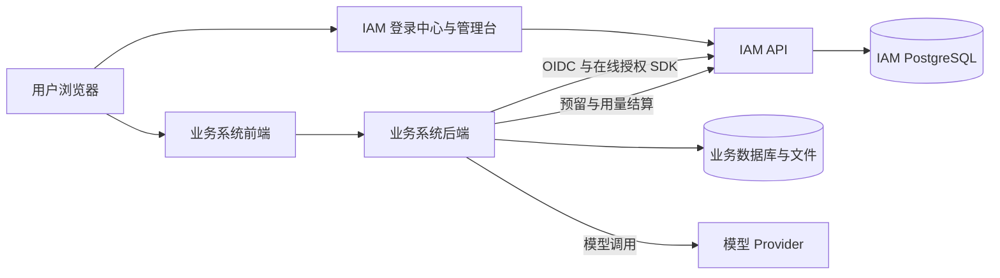

# 技术架构与接入

最后整理：**2026-10-15 P293（Asia/Shanghai）**。本文合并原架构、业务接入和模型治理文档，集中维护工程边界、API/SDK 契约及 DeerFlow 试点技术规则。当前状态与任务依赖以 [项目总览与进度](项目总览与进度.md) 为准；产品规则见 [产品需求](产品需求.md)，环境操作见 [部署与运维](部署与运维.md)，验证证据见 [验收记录](验收记录.md)。历史过程统一进入 [变更记录](../CHANGELOG.md)。

**当前边界（P298）：** 2026-10-16 只读确认开发库 current=head=`0031_model_usage_reconciliation`，`/api/v1/ready` 200，api/console/postgres healthy。备份文件未复核。用量汇总和账目可按模型、结果、UTC 日期筛选；无币种和失败原因字段。A04 真实登录与管理操作仍未验收。DeerFlow 是唯一试点；配额拦截和公开注册继续关闭。本文的简单接入方案属于后续设计。

## 1. 当前架构与职责

IAM 统一维护身份、租户、应用、角色、权限、数据范围、审计与模型用量账目。业务系统使用 IAM 登录和授权结果，在自己的服务端实施资源查询、文件、后台任务及模型调用的权限检查。



| 组件 | 负责 | 约束 |
|---|---|---|
| `frontend/` | Vue 3、TypeScript、Vite、Ant Design Vue 管理台与公开认证入口 | 独立依赖和构建，只通过 HTTP/OpenAPI 使用后端 |
| `backend/` | Python FastAPI、SQLAlchemy、Pydantic、Alembic、PostgreSQL | 服务端认证、默认拒绝授权、事务和审计 |
| `sdk/python/`、`sdk/typescript/` | 业务服务端 OIDC 与在线授权客户端 | 不接管业务数据库，不授予角色，不替代业务 owner 检查 |
| `deploy/`、Compose | 反向代理、环境编排、预检及备份恢复入口 | 普通开发启动不执行迁移或 bootstrap；生产 one-shot migration 受发布门禁保护 |
| DeerFlow Gateway | 可信产品 principal、本地会话/vault、路由授权、后台回调注入 | `resolve_principal(request)` 是产品身份唯一来源 |
| DeerFlow Harness | Agent 运行、模型/工具回调、计量 outbox | 不导入 `app.*`；宿主能力由 Gateway 注入 |
| 实际业务服务/模型网关 | 供应商凭证、Provider 请求、业务数据过滤 | IAM 当前不代理模型请求，也不代管产品数据库 |

工程间依赖顺序为：`frontend feature → shared API client → HTTP/OpenAPI → FastAPI router → services → models → PostgreSQL`；外部业务服务通过服务端 SDK 使用同一契约。不得在后端导入 Vue 源码，也不将 SQLAlchemy 实体共享为前端数据类型。

### 1.1 主要代码入口

| 领域 | 入口与职责 |
|---|---|
| 前端应用壳 | `frontend/src/app/App.vue`、`app/router.ts`、`app/navigation.ts`（`PAGE_PATHS`）、`app/components/AppSidebar.vue`：会话、vue-router 白名单导航、侧栏与响应式入口 |
| 公开认证 | `frontend/src/app/auth/AuthEntry.vue`：登录、注册、邀请、密码重置、OIDC 同意；共享 readiness 异常时禁用提交 |
| 前端领域 | `frontend/src/features/` 下的 overview、integration、audit、invitations、roles、permissions、themes、access-control、applications、application-roles、groups、tenants、users、organizations、tenant-admin、models |
| 网络和外观 | `frontend/src/shared/services/api.ts`：Bearer、合并并发刷新、跨标签页锁与退出广播；`health.ts`：readiness；`shared/theme.ts`：安全主题归一化 |
| 后端装配 | `backend/app/main.py`、`api/v1/admin/__init__.py`：装配路由和统一管理员依赖，不集中堆放领域 handler |
| 认证/OIDC | `api/v1/auth.py`；`api/v1/oidc.py` 是兼容入口，具体实现位于 `oidc_provider/authorization.py`、`tokens.py`、`logout.py`、`metadata.py`、`common.py` |
| 授权 | `api/v1/authorization.py`、`services/authorization.py`、`services/admin_authorization.py`：在线业务判权、默认拒绝、租户/应用委派 |
| 管理领域 | `api/v1/admin/` 下的 users、tenants、applications、access_control、groups、organizations、themes、audit、models、model_usage、invitations、overview |
| 委派入口 | `api/v1/tenant_admin.py`、`tenant_admin_application_roles.py`：租户组织/应用与单应用角色管理 |
| 共享业务规则 | `services/permission_impact.py`：通用 grant 影响估算；`login_throttle.py`：失败节流；`maintenance.py`：分批凭证回收；`theme_config.py`：主题白名单 |
| 数据/API 形状 | `models/` 按领域放实体，`schemas/` 按领域维护请求响应，`migrations/versions/` 只追加 revision |
| 模型治理 | `api/v1/model_usage.py`、`api/v1/admin/model_usage.py`、`schemas/models.py`、`frontend/src/features/models/ModelGovernancePage.vue` |

管理 feature 使用异步模块（`featureLoaders.ts`），首次进入再加载，访问后保留组件实例。公共登录组件先加载，管理组件登录后注册；有 token 恢复会话时 `/auth/me` 与管理组件注册并行。本地直连 dev 默认不用 watch polling；Compose console 设 `VITE_DEV_USE_POLLING=true` 时启用 1000ms polling 适配 bind mount。生产构建将 `ant-design-vue` 拆为独立 chunk。主壳每 30 秒读取 readiness，卸载时清理计时器。具体构建指标属于带日期验证证据，见验收记录（P302）。

## 2. 安全、会话与数据边界

### 2.1 身份与授权

- 租户来自已验证身份和活动 membership；请求里的 tenant 只作查询输入，不能建立可信上下文。应用 ID 也必须与令牌中的应用一致。
- 稳定跨系统身份为 `(issuer, sub)`；产品本地 `user_id` 是映射后的资源 owner 主键。两者不能混用，不能只凭邮箱静默合并身份。
- 每个受保护 API 在服务端判权，界面隐藏和 feature flag 不授予权限。停用权限不参与在线判定，也不能新增 grant；已有关系保留，恢复时可能重新生效。
- 通用 grant 的 `resource_id=NULL` 覆盖该权限码的应用范围；具体实例 grant 只覆盖对应资源。read/write/admin 等权限彼此独立，不自动继承。
- 数据范围只在 RBAC 通过后解析；缺失、空结果、未知结构、跨租户或 owner 与已验签 subject 不一致时拒绝。业务查询必须执行可信范围并保留本地 owner 条件。
- 业务写入与审计共用事务；状态和授权集合变更带期望状态/版本，旧页面发生冲突返回 409，前端重新读取后再操作。

### 2.2 管理员层级与授权主体

平台管理员使用 IAM 管理会话。租户管理员通过 `iam.organization.read/manage` 管理目标租户组织、成员组织归属与数据范围；应用管理通过 `iam.application.read/manage/secret.rotate` 分离目录、资料/状态和密钥轮换。应用管理可授 tenant-wide 角色或绑定 `Role.application_id` 的单应用角色；新建应用需要 tenant-wide manage，受信/静默授权状态仍归平台管理员。

单应用管理员只维护当前 tenant/application 的业务角色、业务权限、已获应用角色的成员和直接绑定，不能新增 `iam.*`，不开放完整租户成员目录；用户组继承只读显示。普通用户可发现自己的 memberships，这不等于能读取租户成员名单。

用户组属于一个租户，成员必须已在该租户，组角色也必须同租户。数据库复合外键和 API 双重检查跨租户关联；在线授权合并直接角色与活动组角色。停用组立即停止继承，但保留成员/角色关系。

通用权限影响预览按直接绑定与活动组继承去重成员，估算其它适用角色的通用覆盖；它没有逐请求模拟实例资源和数据范围的净影响，仍应标注为潜在影响估算。

### 2.3 用户生命周期与会话撤销

`User` 状态为 `active/disabled/locked`；全局停用/锁定递增 `auth_version`，撤销所有租户的管理/OIDC refresh 会话、未消费授权码和 consent ticket。`TenantMembership` 状态为 `active/disabled/departed`；变更递增独立 `membership_version`，只撤销当前租户的应用凭证。离职清理当前租户的角色、用户组、组织关联，保留成员历史，重新加入走新邀请。

管理 refresh 会话以稳定 row ID 标识，access JWT 的 `sid` 对应该 ID；刷新锁行换摘要，保留 ID 和绝对到期。OIDC 申请 `offline_access` 时，access JWT 的 `sid` 关联 refresh-token family；管理员撤销 family 后，IAM 在线 authorization/UserInfo/Introspection 拒绝该会话。没有 `offline_access` 的短期 access token 不进入可续期会话目录。

旧版无 `sid` access token、业务离线 JWT 验签都有自然过期窗口，不能承诺即时撤销。密码重置撤销中心会话，不远程清除产品 Cookie；产品须处理自己的会话。开发 Compose 默认 access token 30 分钟，生产 Compose 默认 10 分钟，具体部署覆盖值另行核实。

**DeerFlow 已确认登出策略：** `/auth/logout` 只删除本地 session/vault，不向 issuer 发送 access/refresh token。SDK 有 RFC 7009 revoke 原语；其它产品选择上游 revoke 或浏览器 end-session 时需要自行确定退出语义，本阶段不将它追加为 DeerFlow 待开发项。

### 2.4 密钥、日志与登录风险

Client Secret、PKCE verifier、access/refresh/ID token、模型服务 key 和供应商凭证只留服务端受保护配置/会话。不要放入浏览器存储、仅签名未加密 Cookie、Prompt、LangGraph 可序列化 config/checkpoint、普通日志或审计详情。Client Secret 创建/轮换只回显一次，响应 no-store，当前立即替换旧值，没有重叠宽限期。

Uvicorn `services/access_log_redaction.py` 隐藏完整 query string；生产 Nginx 访问日志只记录选择后的 `$uri`，OIDC logout 精确路径提高错误日志阈值。外部 CDN/LB/Caddy 自定义日志和业务 RP 仍需各自脱敏，尤其 GET logout 的 `id_token_hint`。

登录 Argon2 验证前检查账号/来源组合桶和来源 IP 桶；只在失败时计数，成功只清当前账号组合桶。`LoginAttemptBucket` 保存 HMAC SHA-256 摘要、失败数和期限，maintenance 分批清过期桶。生产受控代理覆盖专用 `X-IAM-Client-IP`，只有明确可信 CIDR 才接受上游转发；开发不信任代理头。限流参数和生产预检详见部署与运维。

登录主题只接受受控字段、枚举、颜色、数值及 URL，不执行上传脚本或任意 CSS/HTML。注册只能通过 global/app/consumer 三重门禁，challenge 不保存密码摘要，政策和默认普通角色按快照校验；完整产品规则见产品需求，SMTP与迁移门禁见部署与运维。

## 3. 多项目简单接入方案（适配层/路由挂载/CRUD 示例/清单同步已交付；管理台运营向导 P328/P329）

**运营操作以管理台「新项目接入」（`/project-integration`，P328 交互向导，P329 改为 antd Card/Steps/Collapse 展示）为准**：先选方案，再分步完成平台准备，然后按页内示例改业务仓库（env / 登录挂载 / Vue 入口 / check）。完整可运行对照仍是 `examples/iam-crud-fastapi`。P327 一次性说明书与更早五步/DeerFlow 长文已作废。不自动创建租户或应用。管理台壳层为 Ant Design Vue `Layout`/`Menu`/`Drawer`（P329）；业务应用登录品牌仍走 OIDC 主题 CSS 变量，与管理台外观分开。

目标是让每个新项目只维护业务权限和资源 owner；重复的 OIDC、服务端会话、刷新和超时处理由统一接入层承担。第一步复用当前 Python/TypeScript SDK，再提供 FastAPI 和 Node/Express 的薄适配器及模板项目。新项目不复制整套 DeerFlow 的 Gateway/Harness 结构。

| 接入方需要提供 | 接入层拟承担 | 当前实现边界 |
|---|---|---|
| IAM 地址、client ID、服务端 secret、精确 callback | Discovery、登录跳转、一次性 state/PKCE/nonce 校验 | OIDC 客户端已有；登录路由插件双语言已交付（Python `mount_oidc_auth` P318 / Express `mountOidcAuth` P319） |
| 当前应用的权限清单，例如 `todo.task.read/write/delete` | 在线 `requirePermission` 中间件、统一 401/403/503 错误 | FastAPI 适配层已交付（`iam_fastapi`，P316）；Express 适配器已交付（`createIamExpress`，P317）；清单同步工具已交付（`sync_permission_manifest`/`syncPermissionManifest`，P321——只登记目录，角色授予仍走管理台） |
| `(issuer, sub) → local user_id` 与业务 owner 查询 | 提供可信 `currentUser`，在每次请求重新建立上下文 | `IAMFastAPI.current_user` 已交付；持久映射和仓储过滤仍由业务实现 |
| 服务端 session store 与加密 key 注入 | 串行 refresh rotation、令牌安全存储、可选择的本地退出 | 客户端和加密 helper 已有；通用持久会话适配器未实现 |

建议接入流程压缩为四步：

1. 在 IAM 登记一个应用和精确 callback，审核该应用权限清单并给普通/管理员角色明确 grant。新项目默认 owner-only，不因登记应用自动取得管理员或共享数据范围。
2. 业务后端装入对应框架适配器，配置 IAM 地址、client ID、服务端 secret、callback 与 session store。常规部署 issuer 与 API origin 相同可由适配器共用一个地址；不同入口时显式覆盖，不能猜测签发方或把 secret 发到非受信地址。
3. 后端装一次框架插件，自动挂载 login/callback/logout/me（双语言已交付：Python `mount_oidc_auth` / Express `mountOidcAuth`；attempt/令牌只存业务方 `SessionStore`，浏览器仅持 HttpOnly Cookie），受保护路由声明所需 permission；数据查询继续用服务端映射的 owner。复杂模型/工具、后台任务、组织共享按需要另接，普通 CRUD 项目不要求接入模型计量。
4. 前端跳业务 `/auth/login`，读取业务后端 `/auth/me` 拟提供的 `{user,permissions}`，用 `can('document.read')` 控制菜单按钮。该 permissions 是展示快照，执行请求仍在后端逐次判权。

最小业务接口对应 `IAMFastAPI.current_user()`、`require_permission(alias, owner_only=)`（FastAPI 适配层，**已交付**）；`requireOwner` 语义由 `require_permission(..., owner_only=True)` 承担。使用方式：

```python
from fastapi import Depends
from iam_fastapi import IAMFastAPI, IAMUserContext

iam = IAMFastAPI(
    client=IamAuthorizationClient(IAM_API_URL, application_id=IAM_APP_ID),
    session_dependency=load_verified_session,   # 业务方从已验签 OIDC 会话构建；缺失时抛 401
    permission_map={"document.read": "crm.document.read"},
    local_user_id_resolver=lambda user: identity_repo.local_user_id(user.subject_id, user.tenant_id),
)

@app.get("/documents/{document_id}")
def read_documents(user: IAMUserContext = Depends(iam.require_permission("document.read", owner_only=True))):
    # 在业务 handler 中执行；user.local_user_id 已解析，可直接用于 owner 过滤查询。
    documents = repository.list_documents(user_id=user.local_user_id)
```

短别名 `document.read` 必须在 `permission_map` 登记为稳定 code（如 `crm.document.read`），未登记别名在构建依赖时即抛 `LookupError`（fail closed），SDK 不按字符串猜测。`owner_only=True` 请求并校验 IAM owner/self data scope，要求每个 `any_of` 分支都是绑定已验签 subject 的 owner 约束（出现 tenant/organizations 分支即 403），并经 `local_user_id_resolver` 解析产品本地主键；缺映射或解析为空时拒绝。错误映射：IAM 403/503 保留语义，其余契约错误归一 502。OIDC 验签仍由业务方负责（可用 `iam_oidc`）；同步 client 调用由 FastAPI 调度到线程池。

IAM 当前 `/api/v1/auth/me` **不返回 permissions**（界面权限快照仍由业务侧解决）。中央批量判定 API 已具备：`POST /api/v1/authorization/check-batch`（P312，管理台租户控制台在用）可一次判定权限清单；SDK 侧 `check_batch`/`checkBatch` 已交付（P315），涉及 owner-only 数据操作时仍需 data scope。不能只凭一般 grant 允许就显示为数据授权已通过；模型/资源实例 grant 不提前展开成万能快照，执行前仍传精确 resource_id 在线复核。

建议 IAM 登记向导生成后端配置示例和权限清单，默认普通角色只给审核后的功能；现行契约已由 DeerFlow 验证，适配器串接路径由 CRUD 模板项目验证（`examples/iam-crud-fastapi`，P320：`mount_oidc_auth` 登录路由 + `IAMFastAPI` 依赖注入 + `check_batch` 展示快照 + owner 行级过滤，端到端契约测试 3 例全绿）。应用权限清单可经 SDK 同步工具批量登记目录（P321，幂等、只登记不授予）。向导、发布版本、自动会话存储仍需新增任务与验收，不能把文档方案当作已有功能。当前 TypeScript 包 `private:true`，没有公开发布验证；服务端 session/vault 和密钥可以复用已有基础设施，但仍需要部署配置，不能说安全存储无需配置。

每个项目一个 application；应用角色与业务数据独立。若项目面向消费用户，首期推荐独立 consumer tenant；共享全局 IAM identity 通过明确 membership 使用，不跨应用复制角色或认领业务数据。是否一个 Application 覆盖多个客户租户需另行评审。简单接入验收至少包含：登录、正常访问、缺 grant、另一个用户资源 ID、IAM 超时、停用用户/撤权、会话刷新及本地退出。

## 4. 当前 API 与服务端 SDK 契约

本节描述当前源码 API，目标环境须先通过 migration/readiness 门禁。除 `/.well-known/openid-configuration` 外，API 前缀为 `/api/v1`；下表短路径均相对此前缀，带完整前缀的条目按其原样使用。后台 OpenAPI 是运行时路由的机器可读入口。

IAM 管理接口使用 HS256 管理 access JWT 和管理员/委派权限，不把 OIDC client token 当平台管理凭证。OIDC access/ID Token 使用独立 RS256 密钥；业务在线判权接受本 Provider 的 access token，拒绝 ID Token。平台管理员身份仍按服务端 `BOOTSTRAP_ADMIN_EMAIL` 及管理会话边界校验。

### 4.1 当前开发版 API 表

| 接口 | 用途 | 当前约束 |
|---|---|---|
| `POST /auth/login` | 邮箱密码登录 | Argon2 验证；未知用户执行 dummy hash；写入成功/失败审计；按账号/来源及来源 IP 的 HMAC 桶限制失败次数，超限返回 `429` 和 `Retry-After` |
| `POST /auth/password-reset/request` | 申请邮件密码重置 | SMTP 必须已配置；账号存在与否不体现在请求响应；按 HMAC 邮箱键节流；原始 token 不入库，链接 token 放在 URL fragment；前端捕获后立即从地址栏和当前历史记录项清除 |
| `POST /auth/password-reset/complete` | 使用邮件 token 设置新密码 | token 一次性且默认 30 分钟过期；密码至少 12 位；递增 auth_version 并撤销 IAM/OIDC 会话；已验证邮箱标记为已验证；离线 access token 可能活到过期，业务本地 session 由业务系统处理 |
| `POST /auth/register`、`POST /auth/register/verify` | 先申请邮箱 OTP，验证后创建账号/加入产品 | 全局 `ALLOW_PUBLIC_REGISTRATION`、应用 `open`、`tenant.kind=consumer` 三重开启；应用 `client_id` 服务端解析，浏览器不能指定租户/角色；验证前不创建活动用户/membership/会话，也不收/存密码；新用户验证后设置 12 位以上密码，既有身份须输入当前密码；政策 URL/版本随 challenge 固定，发信和兑换时复核，consent 按版本追加；创建/成员/普通角色/会话同事务提交；统一申请文案、HMAC 邮箱/IP 冷却、OTP 失败上限、可重试 outbox；公开注册默认关闭，SMTP/浏览器目标验收未完成 |
| `POST /auth/invitations/inspect`、`POST /auth/invitations/accept` | 预览并接受租户邀请 | 短期一次性 token；新账号须设 12+ 位密码，已有账号须证明当前密码；邀请角色和租户状态在接受时重新校验；前端读取 fragment 后立即清除地址栏和当前历史记录项 |
| `GET /auth/me` | 查询当前身份 | 接受有效 access token 并即时核实状态；返回 UserResponse 的 id/email/display_name/status/created_at，不返回 permissions 快照 |
| `POST /auth/refresh` | 轮换访问令牌与刷新会话 | HttpOnly/SameSite=Lax Cookie；数据库只存摘要、锁行轮换、固定绝对到期；Cookie 路径 `/api/v1` |
| `POST /auth/logout` | 撤销当前管理 access/refresh 会话并登出 | 需要 Bearer；同一事务撤销当前 refresh session 与 access JWT 的 `jti`，并清除 Cookie |
| `GET/POST /admin/tenants`、`PATCH /admin/tenants/{id}/kind`、`PATCH /admin/tenants/{id}/status` | 查询/创建租户、切换类型及启停 | 平台管理员限定；kind 为 organization 或 consumer；切换前须关闭旗下所有应用公开注册；status 带 expected_status，旧状态冲突 409 |
| `GET/POST /admin/applications`、`PATCH /admin/applications/{id}`、`GET /admin/applications/{id}/registration-roles` | 查询/登记应用、配置注册策略和默认普通角色 | 创建请求必须含 1–20 个登录回调且逐项校验；PATCH 可更新资料与 `disabled/open` 注册策略；开放前服务端验证 `consumer` 租户、同租户/同应用普通角色、协议版本及已发布主题政策链接；租户、client_id、密钥、回调和信任状态仍固定；Client Secret 哈希且创建时只回显一次 |
| `PATCH /admin/applications/{id}/status` | 启停 OAuth 应用 | 请求体必须包含 `expected_status` 和 `status`；行锁下拒绝旧状态（409）；停用令牌撤销和 from/to 审计原子提交 |
| `POST /admin/applications/{id}/rotate-secret` | 轮换 confidential client Secret | 立即使旧值失效；`Cache-Control: no-store` 响应只返回一次新明文；审计不保存密钥；管理员必须协调业务端同步更新，无重叠宽限期 |
| `GET/POST /admin/users`、`PATCH /admin/users/{id}/status` | 查询/创建用户，变更全局账号状态 | 仅允许 `active/disabled/locked`；行锁 + `expected_status`，禁止操作自己的当前账号；变更递增全局 `auth_version` 并撤销所有租户的 IAM/OIDC refresh session、未兑换 authorization code 和 consent ticket |
| `GET /admin/users/{id}/sessions`、`POST /admin/users/{id}/sessions/{session_type}/{session_id}/revoke`（`session_type=management\|oidc`） | 查看 IAM 管理台和 OAuth OIDC 应用当前有效的可续期会话，并撤销单个会话 | 平台管理员限定；IAM refresh row ID 在令牌轮换期间稳定，OIDC 用 OAuth refresh-token `family_id` 识别会话；revoke 更新目标记录、撤销整个 OIDC family、写入 `user.session.revoke` 审计。目标是管理员本人时拒绝，避免远程踢掉当前管理身份；不返回 token/hash/IP/UA。在线 IAM、UserInfo/Introspection 立即拒绝新签 `sid` 会话；升级前签发的无 `sid` access token 与纯离线 JWT 验签仍有自然过期窗口。未请求 `offline_access` 的 OIDC access token 不进入持久会话列表 |
| `GET /admin/users/{id}/memberships`、`PATCH /admin/users/{id}/memberships/{tenant_id}/status`（成员变更路由同时挂载 `/tenant-admin`） | 查询成员租户关系，停用/恢复/标记当前租户成员离职 | 写操作要求目标租户 `iam.organization.manage`，授权在路由处理器内检查；状态仅 `active/disabled/departed`；行锁 + `expected_status`；成员状态递增独立 `membership_version`，不撤销同一用户其他租户会话；departed 会清理当前租户的角色/用户组/组织绑定，重新加入只能走新邀请 |
| `GET/POST /admin/groups`、`PATCH /admin/groups/{id}`、`PATCH /admin/groups/{id}/status` | 查询、创建、编辑及启停租户用户组 | 组标识/租户创建后固定；停用立即停止角色继承，成员和角色配置保留；管理员专用 |
| `GET/PUT /admin/groups/{id}/members` | 查询成员清单并全量替换组成员 | 只接受已属于该组租户的用户；写入组关系和审计为同一事务；重复提交幂等 |
| `GET/PUT /admin/groups/{id}/roles` | 查询同租户角色并全量替换组角色 | 跨租户角色返回 422；组内多个角色与成员直接角色、其他组授权一起进入默认拒绝 RBAC 判定 |
| `GET/POST /admin/invitations`、`POST /admin/invitations/{id}/revoke` | 创建、查询或撤销租户角色邀请 | 默认手动复制一次性链接；`IAM_INVITATION_EMAIL_ENABLED` 可启用共享 SMTP 邮件投递，失败时返回备用链接；只存 token 摘要；含明文链接的响应设 `Cache-Control: no-store` 和 `Pragma: no-cache`；默认有效 72 小时、最长 14 天；同租户邮箱待处理邀请由数据库唯一索引保护 |
| `GET/POST /admin/roles`、`PATCH /admin/roles/{id}`、`PUT /admin/role-bindings` | 查询/创建/改角色展示资料、绑定角色 | PATCH 仅 name/description；租户/应用/标识固定；成员与角色同租户 |
| `POST /admin/roles/{id}/clone`、`PATCH /admin/roles/{id}/status` | 复制角色、启停 | 复制要求明确 copy_authorizations，默认 false；同事务审计并核实授权状态；启停带 expected_status，停用角色不参与在线授权 |
| `GET/POST /admin/permissions`、`PATCH /admin/permissions/{id}/status` | 查询/创建权限编码、统计关联角色并停用或恢复 | 响应含 `catalog_namespace`；可选 Query `catalog_namespace` / `application_id` 过滤；创建时 `catalog_namespace` 须与 code 首段一致（`iam.*`→`platform`）；编码不可修改或物理删除；状态变化与审计同事务且须带 expected_status；仅平台管理员可操作 |
| `GET/POST /admin/applications/{id}/permissions` | 按应用 `permission_namespace` 列出/登记权限项 | 创建时 code 须匹配命名空间；`assigned_role_count` 仅统计该应用内角色；租户/平台管理员按既有应用 manage 规则 |
| `PUT/DELETE /admin/roles/{role}/permissions/{permission}?resource_id=...` | 精确单项通用/实例 grant 增删 | resource_id 可选且 1–180 字符；省略是通用授权；停用 code 不能新增，撤销有其它实例支撑时保留数据范围；业务写入与审计同事务 |
| `GET /admin/roles/{id}/permissions`、`POST /admin/roles/{id}/permissions/preview` | 读取通用/资源级授予并预演通用授权集合变更 | 仅平台管理员；预览只读，统计直接绑定及活动用户组继承的去重活动成员，逐权限估算其它适用通用授权覆盖，并列出将清理的数据范围；不逐请求模拟实例资源和数据范围净效应 |
| `PUT /admin/roles/{id}/permissions` | 原子替换角色通用权限 | 单事务保存授权、数据范围清理和审计；资源实例级授予不变；预览版本变化时返回 409，要求重新预览 |
| `GET /admin/themes`、`PUT /admin/themes/{application_id}` | 历史版本查询及保存/发布 | 主题字段/颜色/URL 受控；暂未提供独立匿名主题读取或素材上传，公开登录上下文只回已发布主题 |
| `GET /admin/audit`、`GET /admin/audit/search`、`GET /admin/overview` | 审计查询和概览统计 | 旧 `/admin/audit` 保留记录数组与 limit/action 参数；平台管理员通过 `/admin/audit/search` 进行只读筛选，limit 1–500、offset 0–100000，支持 action/target_type/target_id/outcome/actor_user_id/tenant_id 组合过滤及带时区 start_at（含）/end_at（不含），返回 `{items, limit, offset, total, has_more}` 并按 created_at 与 id 倒序稳定分页；target_type、target_id 与 outcome 当前未单独索引，数据规模增长后需按查询计划补充索引迁移；本次未增加 schema 变更。审计写入与业务写操作在同一事务提交 |
| `GET/POST /admin/models`、`PATCH /admin/models/{id}`、`PATCH /admin/models/{id}/status` | 模型目录查询、新建、非身份字段编辑及启停 | 可编辑 RPM/TPM 并清除限额；租户/模型标识不可变；状态 PATCH 需 JSON `expected_status` + 目标 `status` 并在行锁下防止过期页面覆盖；凭证引用仅接受 `vault://`/`secret://` 且响应和审计摘要不回传引用；Secret Manager 和代理未接入 |
| `POST /api/v1/internal/model-usage` | 可信模型网关上报调用计量 | 需独立 `MODEL_USAGE_API_KEY`；按唯一 request ID 幂等；检查活动租户、模型、应用、用户及成员关系；`usage_is_estimated` 标明估算值；不接收请求/响应文本 |
| `POST /api/v1/internal/model-usage/reservations` | Provider 外呼前预留 | 服务端 MODEL_USAGE_API_KEY，可信 tenant/model/application/user；无论 enforcement 开关均持久化新预留，返回 reservation_required=true、独立 enforced。已有结算/释放关联按终态拒绝外呼；超限 429；先检查 model.invoke |
| `POST /api/v1/internal/model-usage/reservations/settle` | 有效预留的调用结束后幂等结算用量并写入账本 | request ID 必须对应预留；不同载荷重用 ID 返回 409；超预留用量仍记账并标记 `overrun`；`usage_is_estimated` 标明缺少 Provider 实测用量的失败账目；不接收提示词或响应正文 |
| `GET /api/v1/admin/model-usage/summary`、`GET /api/v1/admin/model-usage/events` | 管理员查看模型请求、Token、结果、耗时及费用估算 | summary 与 events 可按可选 `tenant_id`、`model_id`、`outcome`（succeeded/failed）、`created_from`/`created_to`（UTC 自然日，含结束日）筛选；开始晚于结束返回 400。events 默认 limit 100、范围 1–200，支持 offset，返回 `{items,total,limit,offset}`，按时间与事件 ID 倒序。待核对队列不使用这些账目筛选。费用按目录价估算且无币种字段，未配置时为未知；账目无失败原因。不等于真实账单或配额强制 |
| `GET/POST /api/v1/admin/model-usage/reviews` | 管理员分页核对/结算/释放到期预留 | list 默认50、范围1–200、offset非负，返回 items/total/limit/offset；POST decision=settle/release，原因必填，释放需 provider_not_called=true；同事务审计，未到期或并发已处理409 |
| `POST /authorization/check` | 业务服务端 RBAC 判定 | 接受管理会话 HS256 或 Provider 的 RS256 access token；OIDC token 要求 `token_use=access_token`、`aud=client_id`，在线检查用户/租户/应用/活动成员/角色；tenant/application 被绑定到 token 上下文；允许的 OIDC 决策附带可信 `application_id`，默认拒绝 |
| `POST /authorization/check-batch` | 同租户多权限码一次判定（消除逐码往返） | 认证与 `/check` 相同；`permission_codes` 数组 1–32 个且去重；每个权限码独立构造与 `/check` 相同的校验模型走同一判定路径（无批量旁路），返回 `{results: {<code>: {allowed, reason, application_id?}}}`；单码语义与逐个调用 `/check` 一致 |
| `POST /admin/authorization/simulate` | 管理员只读预演指定用户授权并展示判定轨迹 | 仅平台管理员；复用线上判定服务；可选择解析数据范围；不写入角色、策略、审计或业务数据；业务判定 API 不返回诊断明细 |
| `GET/POST /admin/organizations`、`PATCH /admin/organizations/{id}` | 租户部门树查看、新增、修改和启停 | 仅平台管理员；父级必须同租户，数据库复合外键防止跨租户父子关系 |
| `GET /admin/users/{id}/memberships`、`GET/PUT /admin/users/{id}/organizations` | 查询成员租户及替换组织归属 | 必须属于指定租户；支持多组织及一个主组织；关系表复合外键约束租户一致 |
| `GET/PUT /admin/roles/{id}/data-scopes` | 查询或批量替换角色对已授予权限的数据范围 | 只允许配置该角色已有权限；部门清单必须启用且属于角色租户；管理变更写审计 |
| `GET /tenant-admin/members`、`GET /tenant-admin/roles`、`GET /tenant-admin/roles/{id}/permissions` | 只读列出当前租户成员、角色及角色已授予权限 | `iam.organization.read/manage`；成员查询提供 `q/limit/offset` 并只查目标 `tenant_id`，角色和权限清单不跨租户 |
| `/tenant-admin/organizations`、`/tenant-admin/users/{id}/memberships`、`/tenant-admin/users/{id}/organizations`、`/tenant-admin/roles/{id}/data-scopes` | 组织树、成员组织关系和角色数据范围查询/替换；成员变更另有 `PATCH /tenant-admin/users/{id}/memberships/{tenant_id}/status` | 组织相关数据需要目标租户 `iam.organization.read/manage`，平台管理员可跨租户。应用管理角色可通过 memberships 路由发现自己的租户关系，但不能查询其他用户或读取租户成员目录。租户工作台按权限显示读写；越权组织/角色资源按 404 隐藏。权限目录项需通过 `0017` 登记后由管理员显式授予 |
| `GET/POST /tenant-admin/applications`、`PATCH /tenant-admin/applications/{id}`、`PATCH /tenant-admin/applications/{id}/status`、`POST /tenant-admin/applications/{id}/rotate-secret` | 租户应用目录、创建/资料编辑/启停和 Client Secret 轮换 | `iam.application.read` 只读；`iam.application.manage` 允许读取和写应用资料/状态；`iam.application.secret.rotate` 单独控制密钥轮换。权限可由租户角色覆盖全租户应用，或授给绑定 `application_id` 的应用角色以限定单个应用；单独授予 rotate 不开放目录读取。新建客户端需要租户范围 manage。所有路由逐请求校验，受信状态修改仍仅允许平台管理员。权限码由 `0018_tenant_application_admin_permissions` 登记且不自动授权；开发库曾迁移至 0031 有历史记录，但当前状态未验证，其它环境须独立审阅并显式迁移 |
| `GET/POST /tenant-admin/applications/{id}/roles`、`PATCH /tenant-admin/applications/{id}/roles/{role_id}`、`PATCH /tenant-admin/applications/{id}/roles/{role_id}/status` | 单应用角色创建、展示资料与启停 | 每个查询限制应用与租户，写操作要求该应用 `iam.application.manage`；不改变角色tenant/app/标识；状态带expected_status |
| `GET /tenant-admin/applications/{id}/permissions?role_id=...`、`GET/PUT /tenant-admin/applications/{id}/roles/{role_id}/permissions`、`POST /tenant-admin/applications/{id}/roles/{role_id}/permissions/preview` | 单应用业务权限目录、当前grants及通用授权预览/替换 | 必须提供同应用role_id，历史系统权限仅回该角色自身记录；不能新增iam.*；预览复用共享影响估算，不模拟完整实例资源/数据范围净效果；替换要求期望授权集并与审计同事务提交 |
| `GET /tenant-admin/applications/{id}/members`、`PUT /tenant-admin/applications/{id}/role-bindings`、`DELETE /tenant-admin/applications/{id}/members/{user_id}/roles/{role_id}` | 查看已授权成员、直接绑定/移除 | 只绑定已有活动租户成员，不暴露未获本应用角色的租户用户；组继承只读，邀请由租户管理员完成；无需新迁移 |
| `POST /authorization/check`（`include_data_scope=true`） | 在 RBAC 通过后解析有效数据范围 | 返回机器可读 `any_of` 条件；策略缺失/解析为空默认拒绝；业务系统负责映射并执行字段过滤 |
| `GET /.well-known/openid-configuration` | OIDC Provider Discovery | 仅公布授权码、query response、RS256、client_secret_basic 与 S256 等已实现能力 |
| `GET /api/v1/oidc/login-context?client_id=...` | 读取登录应用名称、已发布主题和可用的注册展示上下文 | 公开只读；仅全局开关、应用策略、有效普通角色、活动租户、已发布主题展示项与政策链接均有效时返回 registration，包含当前验证码冷却秒数；不返回密钥或主题草稿 |
| `GET /api/v1/oidc/authorize` | 校验 client、回调、state/nonce/PKCE 并发放一次性授权码 | 只支持 `response_type=code`、`response_mode=query`、PKCE S256；非受信任客户端先进入用户同意；`prompt=none` 不允许绕过同意 |
| `POST /api/v1/oidc/consent/context` | 校验登录会话和短时同意票据并返回应用/用户/租户/范围/主题摘要 | 票据绑定同一用户、一次性且短时有效；响应 `Cache-Control: no-store` |
| `POST /api/v1/oidc/consent/decision` | 用户批准后签发授权码，拒绝则返回 `access_denied` 回跳 | 原子消费票据；授权码和审计同事务提交；响应禁止缓存 |
| `PATCH /api/v1/admin/applications/{id}/trusted` | 管理员显式调整客户端预授权信任状态 | 新应用默认不受信任；信任降级时撤销该客户端已有 OAuth 刷新令牌 |
| `POST /api/v1/oidc/token` | 授权码兑换、OAuth 刷新令牌轮换 | URL-encoded 表单；只支持 `client_secret_basic`；短时单次 code；刷新重放撤销整族 |
| `POST /api/v1/oidc/revoke` | 撤销 OAuth refresh 或 access token | 客户端 Basic 认证；access token 仅可由所属客户端撤销，按随机 `jti` 摘要失效；无效或过期令牌返回幂等成功 |
| `POST /api/v1/oidc/introspect` | 由 confidential client 查询其 token 的实时有效状态 | RFC 7662；必须 `client_secret_basic`；只返回当前有效且属于认证客户端的 access/refresh token claims，其余统一返回 `active:false`；设置 `Cache-Control: no-store`。`token_type_hint` 仅作提示，服务端仍查找两类 token |
| `GET/POST /api/v1/oidc/logout` | OIDC RP-Initiated Logout | 要求有效签名 `id_token_hint`；只撤销该用户/客户端 refresh token，不自动定位已签发 access token；RP 应先调用 `/oidc/revoke` 撤销当前 access token；回跳 URI 精确白名单匹配且必须绑定 state，已登记 URI 不得预设 state；匹配浏览器 SSO Cookie 时一并撤销并清除。GET 的 hint 会出现在 URL；当前 Uvicorn access log 过滤器会隐藏整个 query string，生产 Nginx 只记录 `$uri`，并将此路径的错误日志阈值设为 `emerg`。外部 CDN、负载均衡器、Caddy 自定义访问日志和业务 RP 日志仍须各自配置脱敏；配置语法与 4 项脱敏单测已通过。POST 更适合避免 URL 泄露，但跨站 POST 通常不携带 SameSite=Lax Cookie，可能只完成该 RP 的令牌撤销。 |
| `GET /api/v1/oidc/userinfo` | 以 access token 读取 OIDC 用户声明 | 只返回 token scope 允许的基本 profile/email；每次确认用户、应用、租户角色仍有效 |
| `GET /api/v1/oidc/jwks` | 发布 RS256 公钥 | 不发布私钥；开发签名密钥保存于持久卷，生产须由部署密钥管理注入 |
| `GET /health`、`GET /ready` | 进程存活/服务依赖就绪 | ready 只读复核数据库与 migration head；database_not_ready/database_migration_pending 返回503，不触发迁移；Console200不代表IAM已就绪 |

### 4.2 在线授权请求与数据范围

`POST /api/v1/authorization/check` 使用 `Authorization: Bearer <用户 OIDC access token>`，JSON 请求字段为：

| 字段 | 约束 |
|---|---|
| `tenant_id` | 必填 UUID；等于签发令牌的可信 tenant，API 再核实活动 membership |
| `application_id` | 可选 IAM Application UUID；省略使用 token 应用，不能切换其它应用 |
| `permission_code` | 必填稳定编码，长度 3–180；默认拒绝，不按字符串猜测继承 |
| `resource_id` | 可选，最长 180；由业务服务解析可信目标，不能用任意浏览器 owner/tenant 冒充 |
| `include_data_scope` | 默认 false；true 时要求 RBAC 允许并返回可验证的数据条件 |

正常决策包含 `allowed` 和 `reason`。允许的 OIDC 决策回传可信 `application_id`；DeerFlow adapter 要求它与配置精确一致，缺失或不一致拒绝。普通判权不暴露管理员模拟轨迹。数据范围的实际 JSON 结构为 `data_scope={"mode":"any_of","constraints":[...]}`，constraints 非空；文档中的“any_of 范围”均指该结构。策略缺失或解析为空拒绝，API 不执行业务 SQL。

SDK 只接受三类固定 constraint：`tenant` 带可信 `tenant_id`；`owner` 带 `field="owner_user_id"`、`user_id=<已验签 IAM sub>` 和 tenant；`organizations` 带 `field="organization_id"`、`organization_ids` 和 tenant。所有分支tenant须与本地可信租户一致，未知kind/字段、跨租户、owner错配或非法结构均拒绝。DeerFlow 当前只消费本人owner/self，不开放tenant/organization共享。

Python/TypeScript SDK 请求 data scope 时另要求调用方传入本地已验签 session 的 IAM OIDC `sub`，用于校验 owner，不将该 subject 字段发给 IAM。产品本地用户主键不能替代这一校验。校验后的范围再通过可信 identity/tenant/organization 映射编译为参数化 SQL：每个 OR 分支独立 AND tenant，值进参数数组，列名仅来自业务代码固定映射。空 `organization_ids` 是无匹配，不能删条件变成不限范围。资源表没有必要字段、映射缺失或范围无法执行时失败关闭。

### 4.3 SDK 能力与限制

| SDK/入口 | 当前能力 | 接入方责任 |
|---|---|---|
| Python `iam_authorization.py` 的 `IamAuthorizationClient.check/require/check_batch` | 标准库客户端，调用在线授权，默认 3 秒；`require` 拒绝时抛错；`check_batch` 一次判定同租户多权限码（返回逐码 `AuthorizationDecision` 映射，不携带 data scope） | 从可信 session 取 access token、tenant、subject、app，不接受 ID Token |
| Python `iam_fastapi.py` 的 `IAMFastAPI`（`[fastapi]` extra） | FastAPI 依赖注入式授权适配层：`require_permission(alias, owner_only=)`、`current_user()`；别名强制登记、owner 分支强校验、403/503 语义保留、契约错误归一 502 | OIDC 验签与 session 由业务方提供（`session_dependency`）；`local_user_id_resolver` 负责 IAM subject → 本地主键映射 |
| Python `iam_fastapi_auth.py` 的 `mount_oidc_auth`（P318，`[fastapi]`+`[oidc]` extra） | 一次性挂载 login/callback/logout/me：attempt 原子消费（重放 403）、HttpOnly+SameSite=Lax Cookie、Provider 拒绝不透细节、me 不返回 tokens、logout best-effort 撤销 | 业务方提供 `SessionStore`（put/load/take/delete；生产用 Redis/数据库，`InMemorySessionStore` 仅开发测试）；CSRF 与代理日志脱敏仍由业务方负责 |
| TypeScript `src/express-auth.ts` 的 `mountOidcAuth`（P319，零运行时依赖） | Express 登录路由插件，语义与 Python 侧对称：attempt 原子消费、HttpOnly Cookie（自行解析 Cookie 头，不依赖 cookie-parser）、me 只返回 subject/tenantId/profile、logout best-effort 撤销 | 业务方提供 `IAMAuthSessionStore`（`InMemoryIamSessionStore` 仅开发测试）；CSRF 与代理日志脱敏仍由业务方负责 |
| TypeScript `src/express.ts` 的 `createIamExpress`（P317，零运行时依赖） | Express 中间件：`requirePermission(alias, { ownerOnly })`、`currentUser()`；语义与 Python 侧对称（别名登记、owner 分支强校验、403/503 保留、其余归一 502）；成功时挂 `req.iamUser`/`req.iamDecision` | 结构类型兼容 Express 4/5；OIDC 验签与 session 由业务方 `loadSession` 提供（缺失抛带 `statusCode` 错误转发业务错误处理） |
| TypeScript `IamAuthorizationClient.check/require/checkBatch` | 原生 Fetch、默认 3000ms；请求和响应体读取共享 AbortController 截止时间；`checkBatch` 语义与 Python 侧一致 | 只在 Node/服务端使用，正整数 timeout 可配置 |
| `compile_postgres_data_scope` / `compilePostgresDataScope` | 验证范围后生成参数化 PostgreSQL 谓词 | 可信字段/主键映射并在每条 SQL 中执行；向量/文件等实现等价过滤 |
| Python `iam_oidc.py`、TypeScript Node `IamOIDCClient` | Discovery、Authorization Code+S256、state/nonce/issuer、RS256 验签、UserInfo subject、refresh rotation、RFC 7009 revoke、RFC 7662 introspection、带 state end-session | 一次性 attempt、安全 session store、Cookie/CSRF、并发刷新、身份绑定及产品退出策略 |
| Python `iam_token_vault.py` 的 `IamTokenVaultCipher` | 可选 AES-256-GCM helper，versioned URL-safe envelope，AAD 绑定 issuer/subject/tenant/token type | 恰好 32 字节 key、key_id、DB repository、事务/权限、轮换、清理和审计 |
| Python `iam_deerflow.py` 的 `DeerFlowIamAuthorizationProvider` | 同步/异步授权、data scope、模型 UUID/工具资源映射、候选过滤 | Gateway 可信 principal/vault、配置/显式 grants、本地 owner 与目标环境验收 |
| `examples/iam-crud-fastapi/`（P320，CRUD 模板项目；P322 真实联调闭环） | 把 `mount_oidc_auth`（P318）+ `IAMFastAPI`（P316）+ `check_batch`（P315）+ 清单同步（P321 provision.py 真实使用）串成完整接入路径：登录路由、权限快照端点、文档 CRUD（owner 行级过滤，越权 404）；mock 契约测试 3 例 + 无头验收 `verify_flow.py` 9 项断言对真实 IAM 全 PASS | 真实联调沉淀三点：登录 host 须与 issuer 一致；owner_only 需显式 self 数据范围（默认租户级会被 403 fail closed）；受信应用才可静默授权（无头验收临时开启用后恢复）。生产替换点见该目录 README |
| Python `iam_permission_sync.py`、TypeScript `src/permission-sync.ts` 的清单同步（P321） | 管理面组件：`IamAdminClient` 覆盖 `GET/POST /admin/permissions`（HS256 管理 JWT Bearer；`IamAdminError` 保留状态码、网络 503/契约 502）；`sync_permission_manifest`/`syncPermissionManifest` 幂等同步——清单本地预检（字段/长度/重复码，零网络拒绝）→ 拉目录建索引 → 只创建缺失；409 并发窗口重拉确认（已存在 skipped/仍缺 failed）；单条失败不中断整批；不修改已存在条目、不做角色授予 | 调用方必须持平台管理 JWT（终端用户 OIDC token 会被 403 拒绝）；真实 IAM 联调未做（mock 契约测试 14+13 例）；管理 JWT 的签发/保管属业务运维 |

Python OIDC/vault 依赖通过可选 `[oidc]` extra 引入 PyJWT/cryptography；基础授权客户端保持标准库零依赖。TypeScript OIDC RP 使用 Node Web Crypto/Fetch，无额外运行时依赖，不能打入 Vue 浏览器包。

OIDC 两种 SDK 验证同源 Discovery endpoints、RS256、issuer/audience、callback state/iss、ID Token nonce/at_hash、access-token client/tenant/purpose、UserInfo subject；refresh 验证身份/租户不切换、scope 不扩大、refresh token 确实轮换。授权默认 3 秒，TypeScript OIDC 每个 HTTP 请求默认 5 秒；超时/网络故障分别抛 `AuthorizationServiceError(503)` / `OIDCProtocolError(503)`，HTTP 拒绝保留 IAM 状态码，畸形授权响应按 502 契约错误处理。客户端不自动重试授权操作，也不重试状态不明的 code exchange 或 refresh rotation。

API session、单次 attempt/PKCE verifier 和 token 保存在 Redis/数据库等服务端受保护存储；SDK 不自动创建 Cookie、执行 CSRF、代存 token 或过滤 SQL。敏感操作使用在线授权或 confidential client introspection；`active:false` 或任何协议/网络异常拒绝。一般 RP 可按产品决定调用 revoke/end-session；GET end-session 含 ID Token Hint，须脱敏和消费一次性 logout state。DeerFlow 保持第 2.3 节本地退出策略。

`IamTokenVaultCipher` 只负责加解密，不能代表数据库 vault/在线集成完成。更换 key 时由业务存储记录 key_id，在受控流程中用旧 key 解密、新 key 重加密，验证后再撤销旧 key；helper 不自动轮换。

## 5. DeerFlow 试点接入

工作区为 `D:\project\deer-flow`；修改前读取其 `AGENTS.md`、Skill 和写权限，保留已有改动。该项目有独立 Git 工作区；IAM 目录现也有 Git，但保有未提交修改，提交须按当前交接文件和用户指令处理。以下是现行源码契约，正式配置/目标 migration/角色 grants/真实联调仍待完成。

### 5.1 OIDC、vault 与 principal

Gateway 标准 OIDC 校验链处理 state/nonce/PKCE/签名，再按稳定 provider ID 与 ID Token `sub` 解析本地用户。`provider_id` 必须固定对应 issuer；首次登录固定自动建立普通 DeerFlow User，`admin_emails` 兼容字段不再给新用户提权，现有账号不批量降级。邮箱冲突不自动合并，存量 `(issuer, sub) → local user_id` 绑定/冲突清单仍待输入，完整多身份管理未实现。

OIDC callback 的 `OIDCAuthenticationResult` 令牌字段只供服务端读取，repr 整体脱敏。可信 tenant 来自签名 token，UserInfo 只补 profile，不可覆盖 tenant；UserInfo subject 必须等于已验签 subject。配置请求 `offline_access` 并启用服务端 vault，AES-256-GCM 按 `(user_id, local_session_id)` 存 token，AAD 绑定 issuer/sub/tenant/sid/token type。独立 `DEERFLOW_IAM_TOKEN_ENCRYPTION_KEY` 由服务端 Secret Manager 注入，本地签名 JWT 的 `sid` 仅定位同一登录会话。

Gateway 在 HTTP route、model catalog 和 sandbox-sync 判权时从签名 sid 重载当前 vault；临期 refresh 在行锁下串行轮换。Agent run 使用 repr 脱敏、不可序列化的 `RunContext.authorization_credentials` 和 run-scoped ContextVar，只附给 OIDC subject 匹配的 Principal；不写 `authz_attributes`、LangGraph config/context/checkpoint 或日志。run 在组装模型/工具前复核 session，运行中最多每 2 秒重查，临期刷新。

Adapter 普通授权与范围判定都核对精确 `application_id`；中央 Provider 的 `iam_subject` 必须与可信 `principal.oauth_id` 相同，provider 也须匹配。可配置 `resource_id_resolver` 解析服务器资源；一旦配置，异常、空值或超过 180 字符时拒绝，不退回宽 grant。候选列表按每个 permission+resource ID 判权，不跨资源复用 allow。

**PAT 边界：** PAT 不携带该 adapter 所需的 OIDC vault identity，中央 IAM 保护调用失败关闭，不能拿普通用户 IAM grants 补作认证。PAT 仍受 DeerFlow 本地方法/路径 allowlist，抑制 admin 能力；共享 `USER.md` 等管理能力不对 PAT 暴露。本地运维应急账号另按既有可审计门禁验收。

### 5.2 B01 完整权限映射

本表是 IAM `0026–0030` catalog、DeerFlow `config.example.yaml` 与 Gateway/adapter 的静态映射。Migration 只登记 code，不创建角色或授 grant；下面的范围建议不代表线上配置已落实。

| permission-map key | IAM code | 授权边界 |
|---|---|---|
| `route:read:preferences:read` | `deerflow.preference.read` | 本人偏好读取 |
| `route:write:preferences:write` | `deerflow.preference.write` | 本人偏好修改 |
| `route:read:projects:read` | `deerflow.project.read` | 本人项目/文档读取 |
| `route:write:projects:write` | `deerflow.project.write` | 本人项目/文档变更 |
| `route:delete:projects:delete` | `deerflow.project.delete` | 本人软删除/永久清理 |
| `route:read:threads:read` | `deerflow.thread.read` | 本人线程读取 |
| `route:write:threads:write` | `deerflow.thread.write` | 本人线程修改 |
| `route:delete:threads:delete` | `deerflow.thread.delete` | 本人线程删除 |
| `route:create:runs:create` | `deerflow.run.create` | 本人运行创建 |
| `route:read:runs:read` | `deerflow.run.read` | 本人运行读取 |
| `route:cancel:runs:cancel` | `deerflow.run.cancel` | 本人运行取消 |
| `route:read:agents:read` | `deerflow.agent.read` | 本人自建 Agent 读取 |
| `route:write:agents:write` | `deerflow.agent.write` | 本人自建 Agent 修改 |
| `route:delete:agents:delete` | `deerflow.agent.delete` | 本人自建 Agent 删除 |
| `route:admin:agents:admin` | `deerflow.agent.admin` | 共享 `USER.md`，另需本地管理员 |
| `route:read:memory:read` | `deerflow.memory.read` | 本人记忆读取 |
| `route:write:memory:write` | `deerflow.memory.write` | 本人记忆修改 |
| `route:delete:memory:delete` | `deerflow.memory.delete` | 本人记忆删除 |
| `route:admin:memory:admin` | `deerflow.memory.admin` | 记忆服务配置，另需本地管理员 |
| `route:read:channels:read` | `deerflow.channel.read` | 本人 IM 连接；也用于部署 worker 状态读取 |
| `route:write:channels:write` | `deerflow.channel.write` | 本人 IM 连接修改 |
| `route:admin:channels:admin` | `deerflow.channel.admin` | 部署 channel 凭据/worker 重启，另需本地管理员 |
| `route:read:integrations:read` | `deerflow.integration.read` | 本人外部集成状态读取 |
| `route:write:integrations:write` | `deerflow.integration.write` | 本人集成授权/修改 |
| `route:admin:integrations:admin` | `deerflow.integration.admin` | 部署级组件安装，另需本地管理员 |
| `route:read:skills:read` | `deerflow.skill.read` | 目录与本人自定义技能读取 |
| `route:write:skills:write` | `deerflow.skill.write` | 本人技能修改 |
| `route:delete:skills:delete` | `deerflow.skill.delete` | 本人技能删除 |
| `route:admin:skills:admin` | `deerflow.skill.admin` | 共享技能配置/缓存，另需本地管理员 |
| `route:read:subagents:read` | `deerflow.subagent.read` | 子 Agent 目录元数据 |
| `route:admin:subagents:admin` | `deerflow.subagent.admin` | 部署定义/完整 prompt，另需本地管理员 |
| `route:admin:mcp:admin` | `deerflow.mcp.admin` | 部署 MCP 配置，另需本地管理员 |
| `model:list` | `deerflow.model.list` | 模型目录可见；样例 `filter_actions.model=list` |
| `model:use` | `model.invoke` | 精确配置模型名 → IAM model UUID 的资源 grant |
| `tool:use` | `deerflow.tool.use` | 具体服务端注册工具名作为 resource ID |
| `sandbox:execute` | `deerflow.sandbox.execute` | 沙箱单独按需授予 |

共 **36** 条 permission-map 项，其中 **35** 条 `deerflow.*` code，另 1 条为通用 `model.invoke`。Migration `0026` 另登记了 `deerflow.model.use`，当前配置未引用；两者不能互换。现行部署对具体 model UUID 授 `model.invoke`，不能看到目录项就额外授未用 code；未来改专用 code 需 adapter/config 一致变更与兼容 migration，不能修改已应用历史 revision。

普通角色按启用功能授必要 read/write/delete/create/cancel，并配置本人范围；model list 不等于 model use，模型和工具按批准 UUID/名称做资源级 grant，沙箱另批。运维角色只按需求授 `*.admin`，中央权限与 DeerFlow 本地管理员同时通过；`*.admin` 不自动代替其它 read/write grant。

### 5.3 owner/self 与特殊路径

首阶段项目、线程、运行、文档仅本人可见；其它个人资源沿用相同 owner 规则。DeerFlow 主资源以本地 `user_id` 归属，没有可信 tenant/organization 业务列，vault/usage 中的 tenant 不能当作资源归属。IAM owner/self 必须映射当前主体并与本地 owner filter 求交，broader tenant/organization scope 拒绝；组织共享、可信归属字段、旧数据回填及新迁移放后续评审。

| 路径/行为 | 必须同时满足 |
|---|---|
| 项目/线程列表、按 ID 详情、文档内容/下载、聚合文件、回收站 | 对应 read permission + 本人 IAM scope + 本地 owner；扫描/仓储返回前检查 |
| 项目/文档创建、修改、上传、提升和恢复 | write scope；返回完整资源还要 read scope；提升/挂载线程文件另查 threads read/write |
| 文档软删除、单项/批量永久删除及保留期清理 | projects delete + 本地 owner；恢复先 owner 读取，再验证目标项目范围 |
| 线程 write/delete、运行 cancel | owner-bound 检查与对应目标 ID scope；runs create 在产生 ID 前验证本人范围 |
| `/api/runs/stream`、`/api/runs/wait` | runs create 本人 scope，再由 `start_run` 校验本地 thread owner |
| `/api/assistants/*` 兼容读取 | 同 `/api/agents/*` 的 agents read + 本人范围 |
| Agent/个人记忆完整写响应、技能 update/rollback | read 和 write 的 permission/scope 都通过，检查发生在访问存储前 |
| `/api/console/stats` | runs、threads、agents 三项 read 与本人范围，建立 SQL session 前检查 |
| `/api/console/runs`、`/api/console/usage` | runs 报表要 runs+threads read；usage 要 runs read，均与 owner filter 求交 |
| `/api/threads/{thread_id}/browser/stream` | threads read/write + 对应本人范围、本地 owner、Origin 防护；sid 只留当前连接请求态 |
| `/api/channels` 部署 worker 状态/重启 | read 或 admin route grant；重启还需本地管理员；该共享状态不套个人 self 查询 |
| 个人连接器/偏好 | 独立 read/write + self scope + 本地用户；部署 config/install 走双管理员门禁 |
| 定时任务 | HTTP 本人范围；入队和 durable queue 启动前重新加载 active owner/vault/grants；无有效 session 就暂停并取消排队 |
| 记忆后台写入 | 每次 `apply_changes/save` 和 revision retry 前在 Gateway loop 重新校验 active user、匹配 vault、memory read/write owner 范围 |

记忆队列只留本地 user/thread/agent ID，不存 token/capability；loop/vault/身份/权限异常或 30 秒超时失败关闭。生产 GitHub webhook 禁止 unverified 开发开关；无签名 secret 时不挂载并拒绝运行时调用。真实签名投递仍待部署验收。

Windows 文档保留原显示名和 MIME/转换后缀，路径超过预算时用短内部文件名；后续项目 documents/.short/<digest> 别名保持 stored_relpath/schema 不变，稳定、隔离、复用并兼容 legacy。owner-scoped 自定义技能 purge 已有源码和聚焦验证，尚未进入公开数据任务/API/UI，不能称端到端可用。

### 5.4 部署配置与迁移链

| 项目 | 当前要求 |
|---|---|
| IAM 标识 | tenant/application UUID、受信 issuer/base URL、普通/管理员测试账号及明确 grants |
| OIDC | 稳定 provider ID、精确 HTTPS callback、state/nonce/S256、`offline_access`、server vault |
| IAM adapter | `api_base_url` 配 IAM origin，SDK 拼 `/api/v1/authorization/check`；`application_id`、`oidc_provider`、36 条 permission map、`filter_actions.model=list` |
| 模型/工具 | `model_resource_ids` 按每个 `config.models[].name` 映射 model UUID，含标题/摘要/评估器/子 Agent/记忆模型；工具按具体注册名 grant |
| 密钥 | `DEERFLOW_IAM_TOKEN_ENCRYPTION_KEY`、模型计量 `IAM_MODEL_USAGE_API_KEY` 和 Provider 凭证只入后端 Secret Manager |
| IAM schema | 源码 head 为 0031_model_usage_reconciliation。P298 只读确认开发库 current=head=0031、ready 200；备份文件未复核 |
| DeerFlow Harness schema | `0026_iam_oidc_token_vault → fd_0027_repair_run_change_seq → fd_0028_iam_model_usage_outbox`；目标库 revision 未验 |
| 产品扩展 | product schema 和独立 Alembic 链；按扩展管理器显式安装/审查/启用，本阶段不默认安装可选扩展 |
| 镜像 | dev adapter import 曾有隔离证据，但 2026-10-14 Docker 清理已删除该 dev 镜像；default runtime 尚未产出，重建前需核对 Docker Hub/GHCR 网络；构建 context 排除 config.yaml、extensions_config.json、备份及所有 `.env*` |

正式顺序是 IAM 平台验收后配置 B01/B02、发布 B03，再做 C01/C02。代码配置、dev image import 或 mock 测试不能代替服务启动/目标库/角色 grants/真实 IAM 验收。

## 6. 模型用量、预留与核对

### 6.1 信任边界与现行规则

IAM 提供模型目录、`model.invoke` 授权、准入预留和账目；业务网关验证用户 access token、从自己的 Secret Manager 读 Provider key 并发请求。额度准入不替代模型权限，IAM 不转发 Prompt/响应。网关调用 IAM internal API 使用服务端 `MODEL_USAGE_API_KEY`；DeerFlow 注入名为 `IAM_MODEL_USAGE_API_KEY`，不能交给浏览器或写入运行状态。

| 项目 | 当前规则 |
|---|---|
| enforcement | `MODEL_QUOTA_ENFORCEMENT_ENABLED=false`；reservation 仍持久化，`enforced` 只表示本次是否执行阈值 |
| 限额粒度 | 租户内 model_id 汇总，同模型共享 RPM/TPM；未按用户/应用/角色另分 |
| 未配置限额 | 对应维度不限；只对明确设置的 rpm_limit/tpm_limit 执行拦截 |
| 时间窗 | 最近 60 秒滚动；RPM 计开始请求，TPM 计近期实际 Token 与未结预估 Token |
| 预留 | 输入估算 + 最大输出估算；只有 IAM `allowed:true` 才外呼；超阈值 429，准入异常失败关闭 |
| 核对期限 | 10 分钟；到期进入管理员队列，不自动收费/释放，也不因到期拒绝迟到合法结算 |
| 不确定结果 | Provider 可能已调用但用量不明，保留预留待核对，继续占保守 TPM |
| 真实超预留 | 实际用量照常入账并标记 overrun，之后按真实量计数，不拒绝已发生费用 |
| 幂等 | 逐次调用唯一 request_id；同 ID 同 payload 重投安全，不同 payload 冲突 409；不能因 IAM 超时盲目重发 Provider |
| 费用 | 按模型目录价格估算，未配价格显示未知；不是供应商真实账单 |
| 预算/余额 | 首期不启用月度预算或余额扣减，不能以租户 RPM/TPM 代替新用户成本权益 |

### 6.2 完整调用路径

1. **身份/权限：** Gateway 从已验证会话加载匹配 vault。统一 `create_chat_model()` 给每个实际档案绑定调用前 `model:use` callback，含主 Agent、标题/摘要、目标评估器及子 Agent；拒绝则不外呼。DeerMem 后台另由 Gateway callback 重载用户/vault，验证 memory read/write owner 范围与精确模型档案。
2. **计量身份：** `sub` 是不透明 OIDC subject，不能当 IAM 用户 UUID。使用同一可信 access token 请求 `GET /api/v1/auth/me` 取得规范 IAM user UUID，tenant 来自 vault，application/model UUID 来自服务端配置。
3. **预留：** 每个 LangChain model invocation 生成唯一 request_id，`on_chat_model_start/on_llm_start` 调 `/internal/model-usage/reservations`。IAM 在 enforcement 关闭时也持久化 reservation，返回 `reservation_required=true`、独立 `enforced`；`allowed:false`、429 或准入异常均不得调用 Provider。
4. **Provider：** 业务进程从自己的 Secret Manager 读 key 并调用。每个 instance 绑定 `config.models[].name`；Provider alias/request metadata 不决定计量归属。同步/异步 LangChain 使用同步 callback，通过 callback executor 承载阻塞 HTTP；reserve 错误传播到 dispatch 前。硬超时应小于 10 分钟。
5. **终态/outbox：** 收到可确认终态后，将 request_id、实际/估算 Token、结果和耗时提交 DeerFlow SQL outbox，再幂等 settle/report。一个 Agent run 的多次主/子模型调用逐次结算，不能只记一次 run 汇总。
6. **IAM 落账：** `/reservations/settle` 按同一 request_id 在事务中更新预留和事件；overrun 仍记录。旧 report endpoint 若对应已有预留也会关闭它。终态事件持久重试，已提交事件不因暂时网络失败丢失。
7. **未知结果：** `on_llm_error` 和 callback `close()` 都不能证明 Provider 未收请求，不再合成 failed/0 Token settle。Provider 完成到 outbox 事务提交前崩溃时，IAM 预留保留，但实际 Token 无法自动恢复；到 10 分钟由管理员依据 Provider 日志/账单补记或确认从未外呼后释放。

DeerMem 自建后台模型已接 Gateway 注入的单次 usage callback factory；每次在 serving loop 重载匹配身份，按默认/指定档案建 one-call callback，仅附加到该次 invocation，终态后移除/关闭。debounce queue 不存 token/capability，Harness 不反向导入 Gateway。此项源码与 33/33 关联隔离回归已有证据，仍需目标 Provider/部署验收。

### 6.3 必需配置与 outbox

DeerFlow 在 `authorization.provider.config.model_usage.enabled:true` 时为每个模型配置正整数 `model_usage.reserved_output_tokens.<model-name>`，且 `model_resource_ids` 有精确模型 UUID；默认 enabled false。后端 `IAM_MODEL_USAGE_API_KEY` 至少 32 字符。Prompt/响应只在回调进程内用于估算，不进入 IAM 请求、run state 或日志。计量关闭时行为保持既有路径；启用后任何 admission 失败不外呼。

DeerFlow `fd_0028_iam_model_usage_outbox` 提供 SQL 持久 outbox：唯一 request ID、120 秒 delivery lease、有界指数重试、默认已送达行保留 30 天。outbox 不保存 Provider key；它能重试已提交的终态事件，不能复原 pre-outbox 崩溃的实际用量。IAM reservation 与 DeerFlow outbox 是两个数据库边界，各自 revision/备份/授权验收。

### 6.4 管理员核对与管理台

`GET /admin/model-usage/reviews` 分页返回 `{items,total,limit,offset}`，默认 limit 50、夹紧 1–200、offset 非负，按 expires_at/request_id 稳定升序；只列 reserved 且已到期的预留。`GET /admin/model-usage/events` 与 summary 还可按 model、outcome、UTC 日期筛选，日期颠倒返回 400；events 默认 limit 100、1–200，按创建时间/ID 倒序。待核对列表只按 tenant 过滤。

`POST /admin/model-usage/reviews` 要求 request_id、decision 和原因；settle 补入 input/output tokens、outcome、实测/估算标记、可选 latency；release 必须明确 `provider_not_called:true`。服务按一致 model/reservation 锁顺序与网关重试互斥，同一事务记录决定、操作者、依据和账目；尚未到期/已处理/已有事件返回 409，UI 刷新后再处理。人工事件 `source=admin_reconciliation`，按原始 Provider 调用时间记账，不能用管理员处理时间改变配额窗口。

`ModelGovernancePage.vue` 展示目录、分页账目/待核对、来源和结算/释放表单，不切 enforcement、不读供应商 key、不代理模型。Secret Manager 引用不回传。真实浏览器管理写入和并发核对仍待验收。

## 7. 当前缺口与验收门槛

| 任务 | 现行缺口/下一步 |
|---|---|
| A01–A04 | A01–A03 已完成。P298 只读确认开发库 0031 且 ready 200。A04 真实登录、管理员授权、停用/撤权、会话和用量核对尚未验收 |
| B01/B02 | 正式 IAM 标识、callback、每个模型 UUID、逐工具 grants、self 范围、存量身份冲突清单及 DeerFlow 目标库 revision/secret 注入未齐 |
| B03 | default runtime 镜像/服务启动未验；旧 dev import 不构成部署验收，且镜像已在 2026-10-14 清理中删除；需可用 registry/cache 与安全 context 后重建 |
| B04 | P290 未分片 Windows Python 3.12 离线套件 17,149 passed/404 skipped/3 deselected/1 failed/82 warnings（32:06）；唯一失败为 frontend/src/AGENTS.md 49,630 bytes 超 49,152-byte hard limit 478 bytes | 按用户要求本轮不重跑；下一次手动继续先压缩 guidance，再按指令验证。目标 IAM/Provider/browser 验收仍未完成；P285 分片仅作历史记录 |
| B05 | 内置工厂/Gateway/DeerMem 路径已有接线；动态扩展 Provider 未穷尽，Codex BaseChatModel 内部 HTTP retry 的按 attempt 计费语义未定 |
| C01/C02 | 真实 IAM↔DeerFlow 登录、撤权、跨用户资源、WebSocket/长任务/记忆/定时任务，以及实际 Provider reserve→outbox→settle 故障注入未验收 |
| D02–D04 | 按发布范围补 consumer/SMTP/政策/成本权益、账本审计留存、网关 key 隔离轮换、TLS/DNS/监控/RPO/RTO |
| F01 | 组织共享、多身份管理、无会话后台独立凭证和其它产品接入后续评审；当前无有效会话就暂停 |

权限验收必须覆盖允许与拒绝、停用 permission/user/membership、映射错误、IAM 超时/畸形响应、另一个用户的资源 ID、完整写响应、下载/回收站/聚合、每个辅助模型与工具、流式/后台撤权。用量验收覆盖同步/异步、多模型、重复结算、overrun、Provider 后/pre-outbox 崩溃、迟到结果、管理员证据与 409。

上线前还要确定失败调用计量、限额和压测目标、Provider 查证责任、账本/审计/未结预留留存，以及服务 key 按网关隔离和轮换/吊销。当前共享 key 没有多网关或无停机轮换；request_id 在保留期内不复用，不能直接清空长期未核对项。真实网关迁移、故障恢复与运营工作流通过前保持 `MODEL_QUOTA_ENFORCEMENT_ENABLED=false`。

**2026-10-13 D05 文档合并记录：** 当次仅整理文档，未运行产品构建、未写数据库、未迁移、未调用真实 IAM/Provider、未配置角色 grants。后续 B04 隔离迁移/bootstrap 测试结果见本节任务表及[验收记录](验收记录.md)。既有验证按日期、工作区、mock/隔离和目标环境分列，不能合计为端到端完成。
